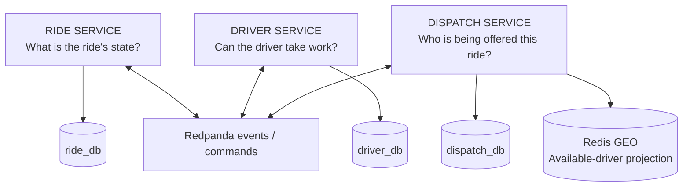
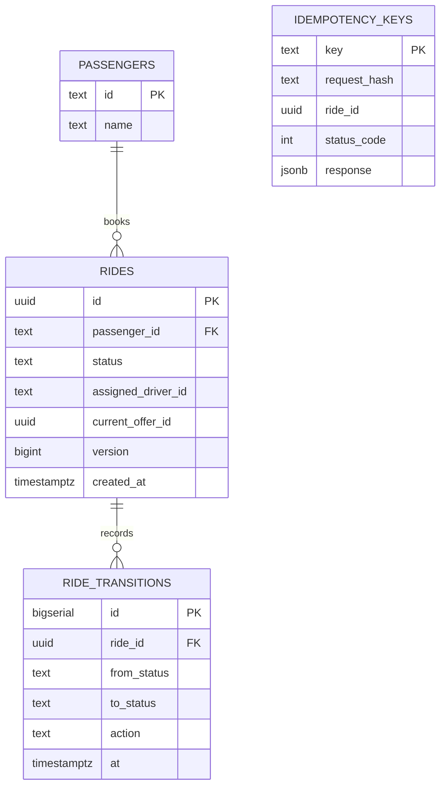
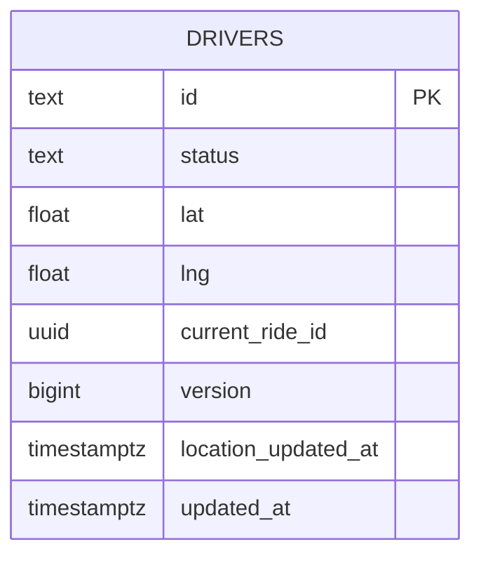
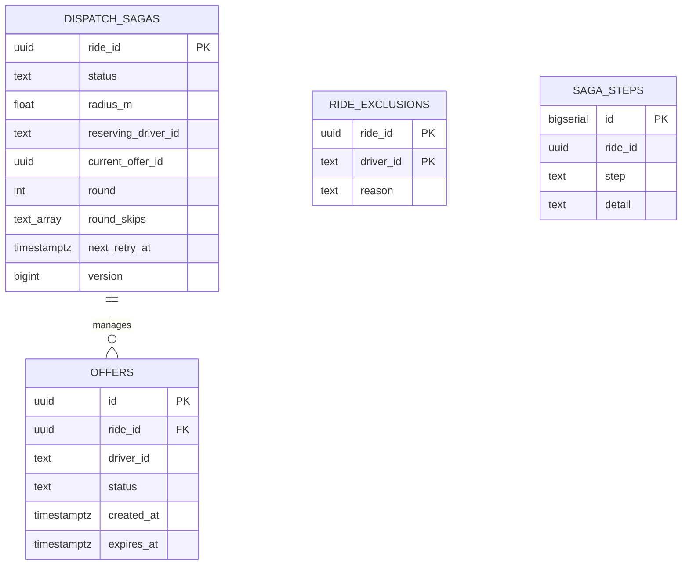
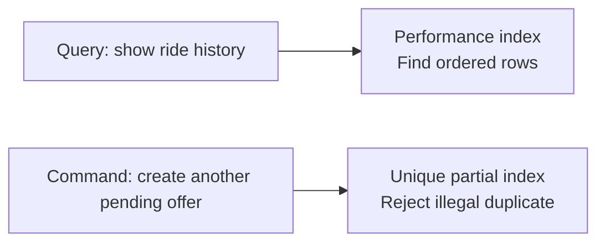
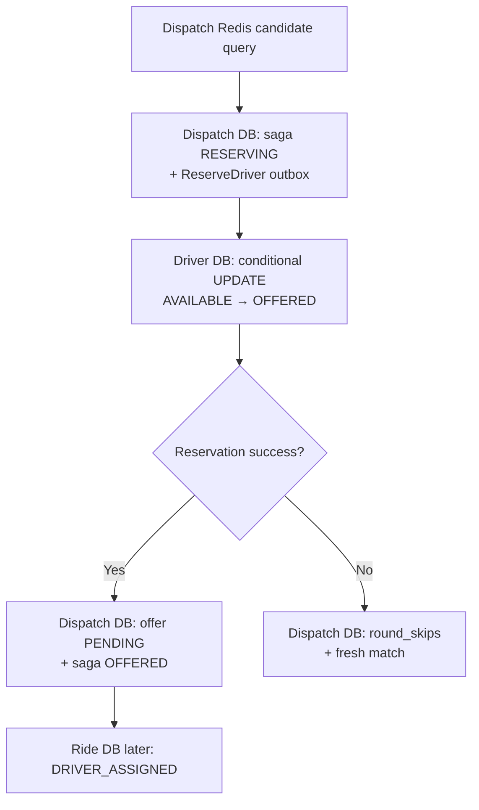
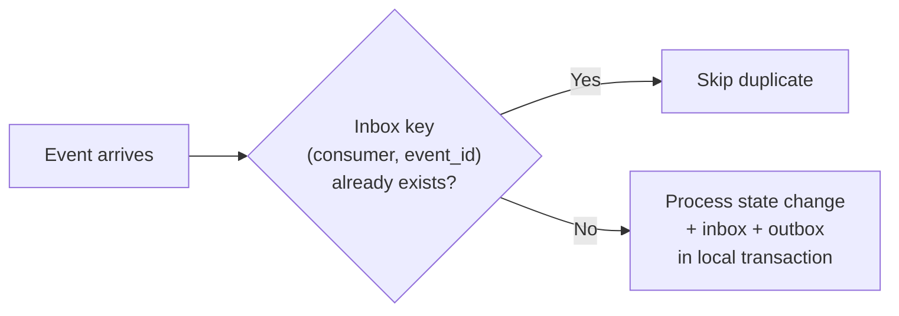

# DATA UNDER PRESSURE

**Team KVP · Database Structure, Indexes & Conditional Updates**  
*Confluence-ready · Visual-first · Source-grounded engineering case study*

> **ONE MESSAGE:** The right data owner controls the state. Indexes protect important invariants and access paths. Each service commits locally; events coordinate what happens next.
>
> **Revision boundary:** This guide uses the supplied local source audit at `349fd59` (reported five commits behind `origin/main`). It is a final presentation-ready explanation of that inspected source, **not confirmation of the latest remote branch**. No SQL `EXPLAIN` or fresh runtime tests were supplied.

---

## 01 / WHY THREE DATABASES?

**One PostgreSQL server locally. Three service-owned databases.**



| Owner | Important data | Guarantee |
|---|---|---|
| **Ride** | `rides`, `ride_transitions`, `idempotency_keys` | Explicit and traceable ride lifecycle |
| **Driver** | `drivers` | Authoritative availability and reservation |
| **Dispatch** | `dispatch_sagas`, `offers`, `ride_exclusions`, `saga_steps` | One orchestrated offer workflow per ride |
| **Each service** | `outbox`, `inbox` | Local transaction + retry/dedup support |

**Why not cross-database foreign keys?** Each service owns its local transactional model. An ID stored in another service represents a logical reference, not an automatically enforced cross-database FK. Local FKs exist where the same database owns both tables.

**Presenter:** “We separated data based on ownership, not merely by table names. The Driver database decides reservation, Ride owns its lifecycle, and Dispatch records orchestration.”

---

## 02 / THE ERD, AS THREE STORIES

### A. Ride database — What happened to the passenger's ride?



**Why this structure?**

- `rides` = current state.
- `ride_transitions` = durable audit/history (one ride has many transitions).
- `idempotency_keys` = retry-safe create behavior.
- `passengers` = local reference validated by FK.

**Important:** `idempotency_keys.ride_id` is a logical reference and **has no FK** in the inspected migration. It is drawn separately to avoid misleading ERD connectors.

### B. Driver database — Who can take this ride right now?



**Why one driver row matters:** The authoritative reservation is a conditional update to this row. A `CHECK` constraint requires `current_ride_id` to be present exactly when status is `OFFERED` or `BUSY`.

**The Redis GEO index is a projection, not a second authoritative driver table.**

### C. Dispatch database — Who is being offered the ride, and why?



**Why this structure?**

- `dispatch_sagas` = current workflow and recovery state; one saga per ride.
- `offers` = individual attempts with expiry and response state.
- `ride_exclusions` = per-ride rejected/timed-out driver IDs, composite PK `(ride_id, driver_id)`.
- `saga_steps` = chronological decision history.

**Important:** `offers.ride_id` has an FK to `dispatch_sagas`. `ride_exclusions` and `saga_steps` have no FK in the inspected migration; they are intentionally drawn without an enforced relation connector.

---

## 03 / WHAT IS AN INDEX? WHY DID WE CREATE THESE?

**An index can serve two fundamentally different purposes:**

1. **Find data faster** — improve an access path.
2. **Forbid illegal data** — enforce uniqueness/correctness.

### Visual: the difference



### Exact explicit indexes in the supplied migrations

| Actual index | Why it exists | Used for / evidence | Main purpose |
|---|---|---|---|
| `ride_transitions_ride (ride_id, id)` | Read one ride's transitions in order | `History`: filter ride, order by ID | **Performance** |
| `dispatch_sagas_active (status, updated_at)` excluding COMPLETED/CANCELLED | Scan active saga state | Supports part of `DueForRetry`; no dedicated index on `next_retry_at` | **Performance** |
| `one_pending_offer_per_driver` unique `(driver_id)` where `status='PENDING'` | No two pending offers for the same driver | `Offers.Create`, pending-driver lookup | **Correctness** |
| `one_pending_offer_per_ride` unique `(ride_id)` where `status='PENDING'` | No two pending offers for the same ride | `Offers.Create` | **Correctness** |
| `offers_expiry (expires_at)` where `status='PENDING'` | Find offers due to expire | `DueExpired` | **Performance** |
| `offers_ride (ride_id, created_at)` | Retrieve a ride's offer timeline | `ListByRide`, `Latest` | **Performance** |
| `saga_steps_ride (ride_id, id)` | Read workflow steps chronologically | `Steps` | **Performance** |
| `outbox_unpublished (id)` where `published_at IS NULL` | Publish only unprocessed outbox rows in order | Outbox relay | **Performance** |

**PK and UNIQUE constraints also create indexes implicitly:** `drivers.id`, `rides.id`, `dispatch_sagas.ride_id`, `offers.id`, `inbox(consumer,event_id)`, `ride_exclusions(ride_id,driver_id)`, etc.

**No explicit index found** on `drivers.status`, `rides.status`, `idempotency_keys.ride_id`, or `dispatch_sagas.next_retry_at` in this inspected migration set.

**Evidence boundary:** Index/query alignment explains intended utility. Without `EXPLAIN (ANALYZE, BUFFERS)` and realistic data, we cannot claim PostgreSQL's planner always uses each performance index or quantify a speedup.

---

## 04 / INDEX CASE STUDY — ONE PENDING OFFER PER RIDE / DRIVER

### Before: an unsafe possibility

```text
Ride R1  --> Pending offer for Driver A
Ride R1  --> Pending offer for Driver B   [INVALID: two pending offers]
Ride R2  --> Pending offer for Driver A   [INVALID: A already pending]
```

### Database protection

```sql
CREATE UNIQUE INDEX one_pending_offer_per_driver
  ON offers (driver_id) WHERE status = 'PENDING';

CREATE UNIQUE INDEX one_pending_offer_per_ride
  ON offers (ride_id) WHERE status = 'PENDING';
```

### After: permitted state

```text
Ride R1 --> [PENDING offer] --> Driver A
Ride R2 --> (different eligible driver or wait)
```

**Why PARTIAL?** The uniqueness restriction applies only to `PENDING` offers. Historical `REJECTED`, `EXPIRED`, `ACCEPTED`, or other closed offers can remain stored for audit without blocking future ride attempts merely due to history.

**What this does NOT replace:** The authoritative Driver Service reservation check is still needed. Offers and drivers live in different service-owned databases.

**Presenter:** “These indexes aren't just speed optimizations. They make an illegal active-offer state impossible to insert in the Dispatch database.”

**Operator (VI):** Click 1 show invalid duplicate attempts; click 2 highlight `WHERE status='PENDING'`; click 3 show valid final state.

---

## 05 / DID WE REMOVE CAS?

**Short answer: Status-based conditional update is present in the inspected code. A version-based driver CAS predicate is not.**

### Three different mechanisms — don't combine them

| Mechanism | What it checks | Found in inspected source? |
|---|---|---|
| **Driver conditional SQL update** | `status = 'AVAILABLE'` at reservation time | **YES** |
| **Version-based driver reservation CAS** | `version = expectedVersion` in reservation WHERE | **NO** |
| **Saga lock + version recheck** | Is the saga still on the state/version read before lookup? | **YES** |

### The important reservation pattern

```sql
-- EXPLANATORY SCHEMATIC, not a verbatim source extract
UPDATE drivers
SET status = 'OFFERED',
    current_ride_id = :ride_id,
    version = version + 1
WHERE id = :driver_id
  AND status = 'AVAILABLE';
```

- **1 updated row** → reservation succeeded.
- **0 updated rows** → reservation failed (driver not in expected state / missing).
- `version` is incremented for state/event versioning; it is **not** a reservation WHERE predicate.

**Was a version-based CAS “removed” historically?** Not established. That needs Git history. What we can say with confidence is what exists in the inspected revision.

### The concurrent race, visualized

```mermaid
sequenceDiagram
    participant R1 as Ride 1
    participant R2 as Ride 2
    participant DB as Driver PostgreSQL
    R1->>DB: Reserve A if AVAILABLE
    R2->>DB: Reserve A if AVAILABLE
    DB-->>R1: Success (illustrative winner)
    DB-->>R2: Failure (zero rows updated)
    Note over DB: Either ride can win; only one updates AVAILABLE to OFFERED
```

The reservation update itself does not use an explicit `SELECT FOR UPDATE` in this path. PostgreSQL handles concurrent row updates. Separate ride/saga transition paths use explicit `FOR UPDATE`; workers and outbox relay can use `FOR UPDATE SKIP LOCKED`.

**Presenter:** “We don't depend on a stale availability read. The conditional write checks availability at the moment we try to reserve.”

---

## 06 / WHAT CHANGES IN THE DATABASE? — ONE RIDE END TO END

**Every panel below shows the owning database's local transaction. Cross-service follow-ups happen later through asynchronous messages.**

### Scene A — Create ride

```text
BEFORE
ride_db.rides:          no R1
ride_db.idempotency:    no key K1

ONE LOCAL TRANSACTION
  insert rides(R1, REQUESTED)
  insert ride_transitions(R1, REQUESTED)
  insert idempotency_keys(K1, response snapshot)
  insert outbox(RideRequested)

AFTER
ride_db.rides:          R1 = REQUESTED
ride_db.outbox:         RideRequested pending publication
```

**Then:** Redpanda → Dispatch inbox/saga `STARTED` → `StartMatching` → ride becomes `MATCHING`.

### Scene B — Select and reserve driver



**Before/after — winning driver**

| Field | Before | After Driver DB transaction |
|---|---|---|
| `drivers.status` | `AVAILABLE` | `OFFERED` |
| `drivers.current_ride_id` | NULL | `R1` |
| `drivers.version` | `v` | `v+1` |

**Important:** A successful reservation does **not** mean the driver accepted. A `PENDING` offer is created next, then Ride Service receives `AssignDriver` asynchronously.

### Scene C — Driver accepts

```text
DISPATCH DB TRANSACTION
  offers:         PENDING → ACCEPTED
  dispatch_sagas: OFFERED → ACCEPTED
  outbox:         MarkDriverBusy + MarkAccepted

LATER IN DRIVER DB
  drivers:        OFFERED → BUSY

LATER IN RIDE DB
  rides:          DRIVER_ASSIGNED → DRIVER_ACCEPTED
  transitions:    append acceptance history
```

### Scene D — Driver rejects

```text
DISPATCH DB TRANSACTION
  offers:          PENDING → REJECTED
  ride_exclusions: add (R1, Driver A)
  dispatch_sagas:  OFFERED → MATCHING
  outbox:          ReleaseDriver + UnassignDriver

AFTER COMMIT
  Fresh Redis query + rerank

LATER
  driver_db:       A released / available
  ride_db:         assignment cleared by command
```

**Key distinction:** Release/unassign commands are queued before the new matching attempt, but their consumers may process them later. Do not portray these as one global transaction.

### Scene E — Timeout

```text
Offer PENDING → time reached
       ↓
Expiry worker checks due PENDING offers
       ↓
Offer EXPIRED + ride exclusion
       ↓
Release / unassign commands
       ↓
Fresh matching
```

The worker uses conditional offer-state updates and locks the saga for coordination.

### Scene F — Passenger cancellation

```text
RIDE DB FIRST
  ride status → CANCELLED
  history entry + RideCancelled outbox
       ↓ asynchronous
DISPATCH DB LATER
  saga → CANCELLED
  close a still-pending offer if applicable
  queue driver release if a driver was held
       ↓ asynchronous
DRIVER DB LATER
  release the driver if held by this ride
```

**No rematching** after passenger cancellation.

### Scene G — Ride completion

```text
RIDE DB:       DRIVER_ACCEPTED → COMPLETED
               append transition + RideCompleted outbox
       ↓
DISPATCH DB:   saga → COMPLETED + ReleaseDriver command
       ↓
DRIVER DB:     BUSY → AVAILABLE
```

### Scene H — Duplicate delivery



**Why the inbox primary key matters:** It makes duplicate event claims collide on `(consumer,event_id)`, supporting idempotent consumer processing.

---

## 07 / OTHER IMPORTANT INDEXES — BEFORE AND AFTER

### Ride history

```sql
CREATE INDEX ride_transitions_ride ON ride_transitions (ride_id, id);
```

```text
Question: “Show the history of Ride R1 in order.”
Query pattern: WHERE ride_id = R1 ORDER BY id
Index order:   (ride_id, id)
```

### Expired offers

```sql
CREATE INDEX offers_expiry
  ON offers (expires_at) WHERE status = 'PENDING';
```

```text
Question: “Which still-pending offers have expired?”
Access path: narrow to PENDING, then scan expiry ordering
```

### Outbox publishing

```sql
CREATE INDEX IF NOT EXISTS outbox_unpublished
  ON outbox (id) WHERE published_at IS NULL;
```

```text
Question: “What unpublished messages should the relay send next?”
Access path: only rows still awaiting publication, in ID order
```

### Saga retry

```sql
CREATE INDEX dispatch_sagas_active
  ON dispatch_sagas (status, updated_at)
  WHERE status NOT IN ('COMPLETED','CANCELLED');
```

**Trade-off:** Supports active-state filtering, but `next_retry_at` is not separately indexed in the inspected schema. Do not claim an optimized timed-retry query without query-plan evidence.

---

## 08 / WHY NOT JUST ADD MORE INDEXES?

Indexes are not free:

- Every insert/update may have to maintain index entries.
- More indexes consume space.
- A status-only index may have limited usefulness on small or low-selectivity data sets.
- Choose indexes from actual queries, constraints, and observed query plans—not from column names alone.

**Current evidence:** We know why the inspected queries and constraints align with these indexes. We do **not** have production-like `EXPLAIN ANALYZE` evidence establishing their measured benefit.

---

## 09 / THE SIX-CLICK DATABASE STORY

| Click | Visual | One message | Operator note (VI) |
|---|---|---|---|
| 1 | Three database ownership cards | “Each service owns its truth.” | Hiện 3 DB rồi Redis projection |
| 2 | ERD Ride / Driver / Dispatch | “State, history, and workflow have different homes.” | Mở từng ERD, không mở cùng lúc |
| 3 | Two unique partial offer indexes | “Some indexes protect correctness.” | Đánh dấu hai dòng `WHERE PENDING` |
| 4 | Two rides race for one driver row | “The conditional UPDATE determines the winner.” | Một WIN, một FAIL; winner chỉ illustrative |
| 5 | Reject → exclusions → fresh matching | “Different databases converge asynchronously.” | Hiện transaction boundaries |
| 6 | History, expiry and outbox indexes | “Other indexes help read and process the data.” | Chỉ mở query phù hợp, không liệt kê toàn DDL |

**Recommended presentation duration:** 2–3 minutes. The full ERD/index catalog remains expandable for Q&A.

---

## 10 / QUICK Q&A

**Q: Did we remove CAS?**  
A: Inspected Driver reservation still uses a status-conditional SQL update. There is no driver `version = expected` predicate. Historical removal is unverified.

**Q: Are `FOR UPDATE` locks the same as reservation CAS?**  
A: No. Ride and saga transitions explicitly lock rows. Driver reservation uses an atomic conditional UPDATE. Workers may use `SKIP LOCKED` to avoid blocking.

**Q: Why both unique offer indexes and driver reservation checks?**  
A: They protect invariants in different service-owned databases. Driver DB protects the reservation; Dispatch DB protects pending offers.

**Q: Why no FK from offer to driver?**  
A: Driver and Dispatch are separate owned databases. The relationship is logical and coordinated through commands/events, not a local cross-service FK.

**Q: Is `version` unused?**  
A: No. Version is incremented and helps state/event ordering and saga stale-result handling. It is not the Driver reservation predicate.

**Q: Does every index make the relevant query faster?**  
A: Not necessarily. Query plans and realistic volume are needed for verified performance claims.

**Q: What if Redis says AVAILABLE but Driver DB says BUSY?**  
A: The conditional Driver DB update fails; Dispatch temporarily skips that driver and freshly matches again.

**Q: What if no candidate remains?**  
A: Dispatch saga waits for retry/availability while ride remains MATCHING, rather than automatically failing.

---

## 11 / SOURCE MAP AND VERIFICATION

| Source | Evidence |
|---|---|
| `001_rides.sql`, `002_trace.sql` | Ride tables, constraints, optional tracing column |
| `001_drivers.sql` | Driver row, states and `current_ride_id` check |
| `001_dispatch.sql`, `002_trace.sql` | Sagas, offers, exclusions, steps and offer indexes |
| `000_messaging.sql` | Inbox, outbox and unpublished partial index |
| `pgutil.go` | Migration runner and local transaction helpers |
| Ride/Driver/Dispatch `postgres.go` adapters | Queries, conditional update and row-lock behavior |
| `offers.go`, `orchestrator.go`, `drivers.go`, `rides.go` | State transitions and commands |
| `outbox.go` | Message relay / transactional outbox |

**Known source boundaries:** `349fd59` is the last inspected local state, reportedly five commits behind remote. No new remote HEAD, SQL `EXPLAIN`, or integration execution was available in the supplied report. Confirm final demo SHA and rerun tests before publication.

**Final line:** **Ownership defines truth. Conditional writes preserve correctness. Indexes enforce or accelerate the rules.**
