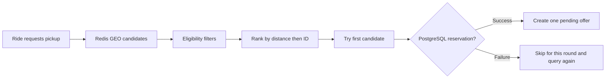
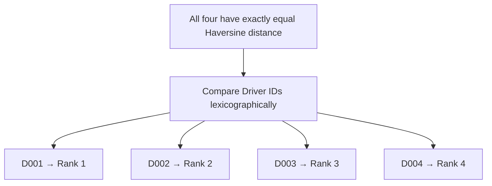
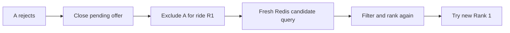
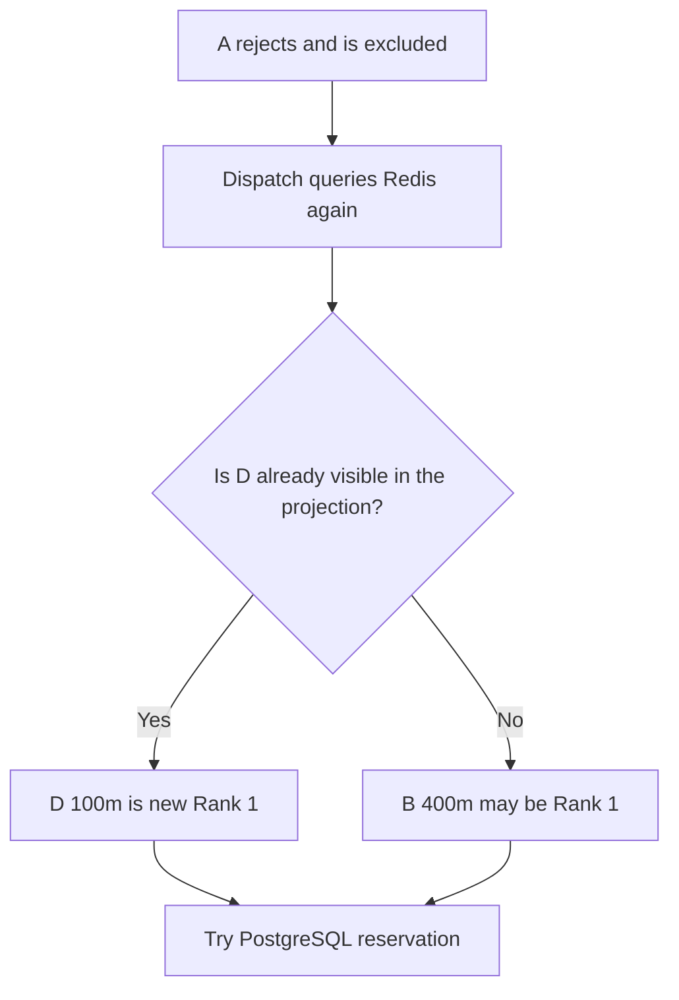
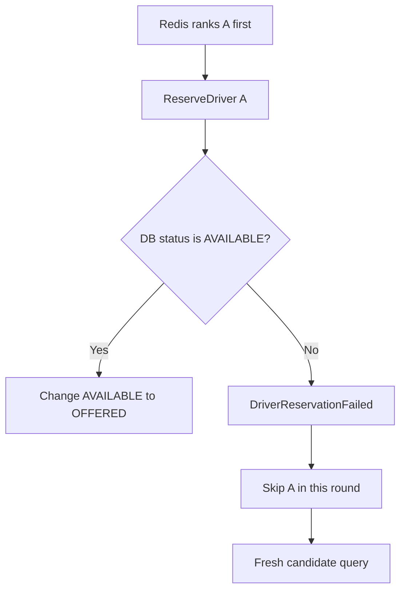
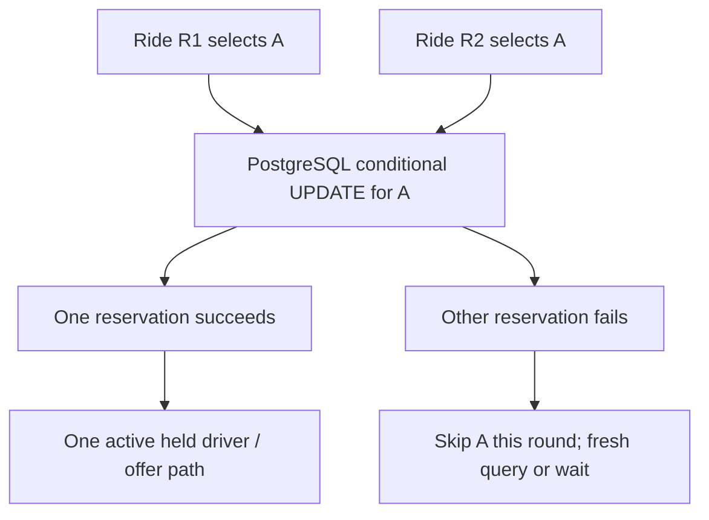
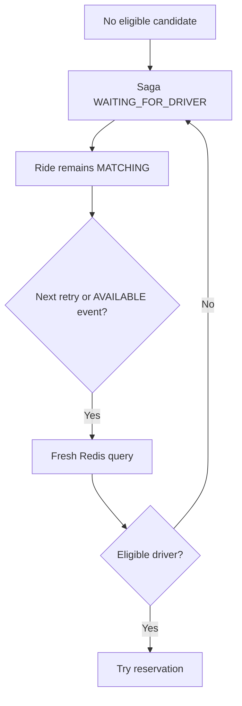
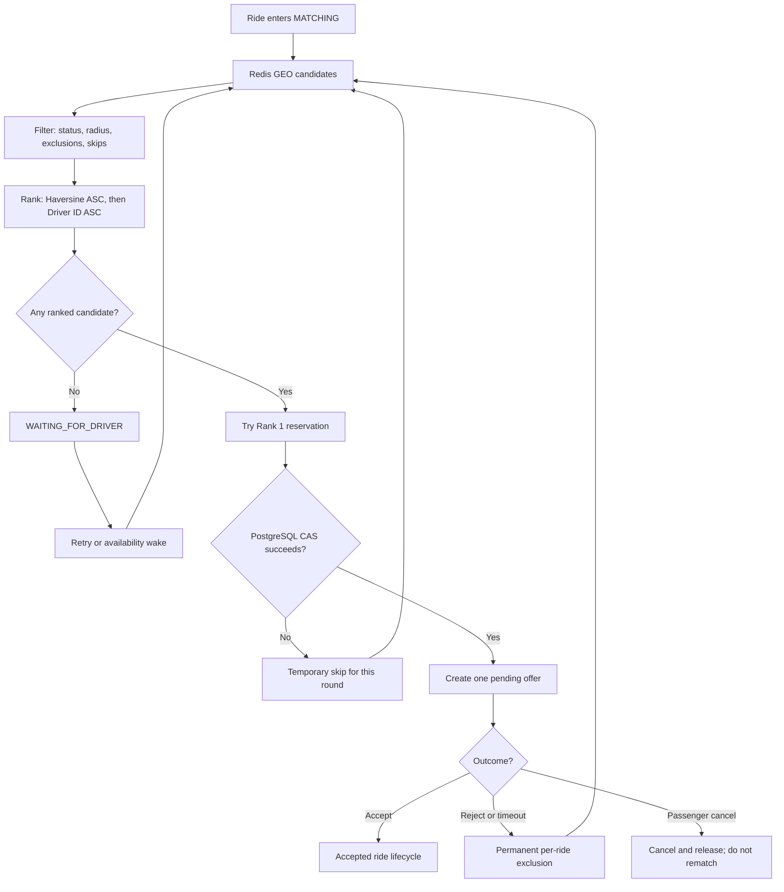

# DISPATCH UNDER PRESSURE

## WHO GETS THE RIDE?

**Team KVP · TWVN Coding Challenge #3 · Visual case-study edition**  
**Theme:** One ride. Many guarantees.  
**Format:** Confluence-style long-scroll story; each scene = one reveal.  
**Evidence:** Based on KVP source investigations supplied for `Rank`, `SelectNearest`, `match`, `Reject`, `endOffer`, Redis `Candidates`, and PostgreSQL `ReserveIfAvailable`.

> **READ THIS FIRST — THE FOUR RULES**  
> **Filter:** projected AVAILABLE, not excluded/skipped, within exact radius (default **2,000 m**).  
> **Rank:** smaller **computed Haversine distance** first. If *exactly equal*, **Driver ID ascending lexicographically**.  
> **Reserve:** ranked #1 is only the **first attempt**; PostgreSQL must atomically confirm `AVAILABLE → OFFERED`.  
> **Rematch:** reject/timeout/failure triggers **a new Redis query**, not promotion from a saved queue.

**Visual legend:** 🟢 eligible · 🟡 trying reservation · 🔴 rejected/excluded · ⚪ unavailable · 🔵 offered · 🟣 waiting. All locations/distances below are **illustrative**, not live telemetry. The scene marked “next click” is a storyboard instruction; Markdown itself does not animate.

---

# 01 / THE DECISION IN 10 SECONDS

## Nearby ≠ eligible ≠ reserved



| Decision | What the audience needs to remember |
|---|---|
| Discovery | Redis provides a **bounded, eventually consistent** nearby candidate snapshot. |
| Eligibility | Projected status is AVAILABLE; within exact radius; not in this ride's exclusions or round skips. |
| Ranking | **Distance ASC → Driver ID ASC on exact ties.** Not rating, age, acceptance rate or priority. |
| Reservation | Driver Service's **PostgreSQL conditional UPDATE** is authoritative. |
| Offer strategy | **Sequential for each ride:** one reserving candidate/current pending offer, not a simultaneous broadcast. |

**Presenter (10–15 sec):** “We choose the nearest eligible candidate first. But choosing and reserving are different decisions. Redis suggests a candidate; PostgreSQL decides whether they're actually free.”

**Operator (VI):** Hiện flowchart trước; click tiếp chuyển qua ví dụ filter và ranking. Không gọi candidate được chọn là “đã book” trước khi CAS thành công.

---

# 02 / DISCOVER → FILTER → RANK

## Some drivers look close. Only eligible ones make the list.

**Illustrative input — default radius 2 km**

| Driver | Computed distance | Projected status | Per-ride excluded? | Outcome |
|---|---:|---|---|---|
| C | 100 m | BUSY | No | ⚪ Filtered: not AVAILABLE |
| A | 200 m | AVAILABLE | No | 🟢 Rank 1 |
| B | 400 m | AVAILABLE | No | 🟢 Rank 2 |
| D | 800 m | AVAILABLE | Yes | 🔴 Filtered: excluded |
| E | 2,500 m | AVAILABLE | No | ⚪ Filtered: outside radius |
| F | 900 m | AVAILABLE | No | 🟢 Rank 3 |

### Reveal 1 — Candidate snapshot

```text
PICKUP 📍
C   100 m  BUSY         A   200 m  AVAILABLE
B   400 m  AVAILABLE    D   800 m  EXCLUDED
F   900 m  AVAILABLE    E  2500 m  OUTSIDE RADIUS
```

### Reveal 2 — Filters applied

```text
REMOVED:  C [BUSY]      D [EXCLUDED]      E [> 2km]
KEPT:     A [200m]     B [400m]         F [900m]
```

### Reveal 3 — Ranked list

```text
🥇  A   200 m   → first RESERVATION ATTEMPT
🥈  B   400 m
🥉  F   900 m
```

**Takeaway:** The closest driver on the map can be ineligible. We rank **eligible** candidates, not every nearby driver.

**Presenter:** “Driver C is closest, but BUSY. D has already been excluded from this ride, and E is beyond the search radius. That leaves A, B and F; we rank them by exact computed distance.”

**Operator (VI):** Reveal lần lượt tất cả markers → làm mờ C/D/E → show queue A/B/F. Dùng đúng nhãn `projected status` vì Redis không phải source of truth.

---

# 03 / THE TIE-BREAKER — MORE THAN TWO DRIVERS CAN TIE

## Four equal-distance drivers. Still only one final Rank #1.

**Question:** D001, D002, D003 and D004 are all AVAILABLE, all eligible, with **exactly equal computed Haversine distance**. Who goes first?

### Reveal 1 — They are tied on the primary criterion

```text
                 PASSENGER 📍
           ┌─────────┼─────────┐
           │         │         │
        D003       D001       D004       D002
        200 m      200 m      200 m      200 m
       AVAILABLE  AVAILABLE  AVAILABLE  AVAILABLE

        Distance alone: all TIED for NEAREST
```

### Reveal 2 — Apply deterministic secondary ordering



### Reveal 3 — One candidate is attempted first

```text
FINAL ORDER (equal computed distance)
🥇 D001  →  Try reserve
🥈 D002  →  Candidate
🥉 D003  →  Candidate
   D004  →  Candidate
```

### What exactly is a tie-breaker?

A **tie-breaker** is a secondary comparison rule used **only when the primary comparison cannot distinguish candidates**. Here:

1. Compare Haversine distance (numeric ascending).
2. **Only if those computed values compare exactly equal**, compare Driver ID (string/lexicographic ascending).
3. Select the first-ranked candidate for the **reservation attempt**, not an immediate offer.

### Why ID, not a random pick?

- **Deterministic:** same inputs produce the same order.
- **Simple to reason about and test:** no hidden random tie decision.
- **Does not pretend to be fairness:** lower IDs can be repeatedly preferred in exact-tie situations.

### Critical precision: a visual tie may not be a code tie

| Driver | Actual computed distance | Rounded screen label | Real priority |
|---|---:|---:|---|
| D009 | 200.0001 m | 200 m | First |
| D001 | 200.0002 m | 200 m | Second |

**Even though both labels say “200 m”, the values are not equal.** The nearer computed distance wins; ID is **not** consulted. To demonstrate a true tie, use identical candidate coordinates and verify the computed values are equal.

**Presenter:** “Multiple candidates can tie on distance — two, four, or ten. We need a deterministic order, so the smaller driver ID wins **only on an exact computed-distance tie**. Four drivers may be equally near, but there is still one first reservation attempt.”

**Operator (VI):** Scene 1 = 4 cards cùng 200 m. Scene 2 = show ID sort. Scene 3 = highlight D001. Sau đó click reveal bảng `200.0001` vs `200.0002` để giải thích rounded label ≠ exact tie.

**Evidence:** `Rank`, `SelectNearest`; matcher unit test `TestEquidistantPicksSmallestDriverID` passed in the supplied local investigation.

---

# 04 / TIE + RESERVATION FAILURE

## The first-ranked driver isn't always the one who gets the offer.

**Initial:** D001, D002 and D003 all have exactly equal distance. ID order is D001 → D002 → D003.

### Reveal 1

```text
🥇 D001  200 m  → TRY RESERVATION
🥈 D002  200 m
🥉 D003  200 m
```

### Reveal 2 — D001 lost a race to another ride

```text
D001  →  PostgreSQL status no longer AVAILABLE  →  RESERVATION FAILED
```

### Reveal 3 — New candidate query

```text
Temporary round skip: D001
Fresh Redis read + rank (if other inputs are unchanged):
🥇 D002  200 m  → TRY RESERVATION
🥈 D003  200 m
```

**Important:** D001 is **temporarily skipped for this matching round**, not permanently banned for the ride by a reservation failure. D002 receives an offer **only if its own reservation succeeds**.

**Presenter:** “The tie-breaker determines which driver we try first. It doesn't guarantee that driver gets the offer. If D001 loses the database reservation race, Dispatch queries again and can attempt D002.”

---

# 05 / TOP 1 REJECTS

## When A says no, does old Top 2 automatically win?

**Initial:** A 200m · B 400m · C 600m, all eligible.

### Reveal 1 — A has the offer

```text
RIDE R1 → A 200m [PENDING OFFER]
B 400m [candidate]    C 600m [candidate]
```

### Reveal 2 — Reject and exclude

```text
A [REJECTED] → ride_exclusions(R1, A)
Queue ReleaseDriver(A) + UnassignDriver(R1)
```

### Reveal 3 — New query, not old-list promotion



### Reveal 4 — Assuming nothing else changed

```text
A 200m  🔴 EXCLUDED FOR R1
B 400m  🥇 NEW RANK 1 → TRY RESERVATION
C 600m  🥈 NEW RANK 2
```

**Takeaway:** B is next **only if B is still the nearest eligible driver in the fresh snapshot**. Dispatch does not cache a permanent candidate queue.

**Presenter:** “Rejecting A closes the offer and excludes A for this ride. Then we search and rank again. B may now be first — but not simply because B used to be second.”

**Operator (VI):** Cho A chuyển đỏ, show bảng exclusion, reset ranking, reveal fresh snapshot, highlight B; không hiện `B OFFERED` cho tới khi reservation thành công.

---

# 06 / A NEW CLOSER DRIVER APPEARS

## Can D jump ahead of old Top 2?

**Initial:** A 200m · B 400m · C 600m. A rejects. New D becomes AVAILABLE at 100m.



| When new D becomes visible | Next first attempt, assuming no other changes |
|---|---|
| Before Redis query | **D** at 100 m |
| After Redis query / after B's offer is created | **B** may already be selected; D does not preempt that existing offer |

**Takeaway:** Fresh rematching can respond to a new driver, but visibility is subject to asynchronous Redis projection timing.

**Presenter:** “If D appears in Redis before our fresh query, D can be the new closest candidate. If the event arrives too late, B may already hold the offer. We don't preempt an active offer.”

---

# 07 / REDIS SAYS AVAILABLE; POSTGRESQL SAYS BUSY

## The ranking winner loses at the database gate.

### Reveal 1 — Projection snapshot

```text
REDIS GEO + HASH:  A · 200m · AVAILABLE
```

### Reveal 2 — Authoritative check

```text
DRIVER POSTGRESQL: A · OFFERED / BUSY (another ride)
```

### Reveal 3 — Decision



**Takeaway:** Redis is a **projection**, not the authority for driver reservation. A stale candidate never automatically becomes a successful offer.

**Presenter:** “Our index can be stale. That's expected in an event-driven system. The conditional database update protects the actual reservation.”

---

# 08 / TWO RIDES SELECT THE SAME TOP 1

## Two rides. One driver. Only one successful reservation.

This is **not** the same as multiple drivers tied on distance. Here two independent rides each select **Driver A** as their own Rank 1.

### Reveal 1 — Both see A

```text
RIDE R1  ─────►  DRIVER A ◄─────  RIDE R2
  TOP 1               AVAILABLE       TOP 1
```

### Reveal 2 — Two reservation commands compete



### Reveal 3 — Example outcome

```text
R1 → A: SUCCESS  → A becomes OFFERED for R1
R2 → A: FAILED   → R2 re-queries; tries B or WAITING_FOR_DRIVER
```

**Note:** R1 winning is illustrative. Either ride can win, depending on transaction order.

**Takeaway:** Multiple rides can have the same Top 1 **in their own ranked lists**. PostgreSQL's `UPDATE ... WHERE status='AVAILABLE'` ensures only one wins the actual reservation.

**Presenter:** “This is the concurrency guarantee we're proud of. Two requests can see the same candidate — that's okay. The authoritative database row permits one successful reservation. The other ride continues matching.”

**Evidence:** `ReserveIfAvailable`; integration tests `TestConcurrentReservationOnlyOneWins` and `TestTwoRidesCannotOfferTheSameDriver` exist but were not run in the supplied investigation.

---

# 09 / AN OFFER TIMES OUT

## No response is an outcome too.

**Default pending-offer timeout: 30 s** (configurable).

```text
T0          Driver A gets PENDING offer
  │
  ▼
T+30s       A has not accepted
  │
  ▼
Sweeper     Mark EXPIRED → Exclude A for this ride
  │
  ▼
Rematch     Release/unassign enqueued → fresh Redis query
  │
  ▼
Next        Try B if newly ranked #1 and reservable
```

**Takeaway:** Timeout uses the rejection/rematching path. An expired driver is excluded **for that ride**, not banned globally.

**Presenter:** “If A doesn't respond before the offer expires, the timeout worker closes the offer and rematches. We don't leave a pending offer open forever.”

---

# 10 / EVERY CANDIDATE IS GONE

## Waiting is not the same as failing.

**Scenario:** A rejects, B rejects, C times out; no unexcluded AVAILABLE candidate remains.



**Key nuance:** The next availability event can wake a waiting saga; scheduled retries also occur. A mere location update does not directly trigger the same wake-up path. The code has no maximum wait or automatic transition to FAILED for this case.

**Presenter:** “When everyone is unavailable or excluded, the ride stays MATCHING and the saga waits. A new eligible driver can be considered on a later retry.”

---

# 11 / REJECTED A MOVES EVEN CLOSER

## Excluded for this ride ≠ unavailable for every ride.

```text
RIDE R1                      RIDE R2
A rejected R1 earlier        A has not rejected R2
A now moves to 50m           A is 50m away
A: 🔴 EXCLUDED                A: 🟢 ELIGIBLE (if AVAILABLE)
B: 🥇 possible Rank 1         A: 🥇 possible Rank 1
```

**Takeaway:** `ride_exclusions` records a **(ride_id, driver_id)** relationship. Moving closer does not undo rejection for the same ride; another ride may still consider A.

**Presenter:** “The exclusion is per ride, not a permanent punishment for the driver.”

---

# 12 / REJECT, TIMEOUT, RESERVATION FAILURE, CANCEL — NOT THE SAME THING

| Event | What changes? | Exclusion / skip | Matching again? |
|---|---|---|---|
| Driver rejects current offer | Offer becomes REJECTED; release/unassign queued | **Permanent for this ride** | **Yes**, new Redis query |
| Offer expires | Offer becomes EXPIRED; release/unassign queued | **Permanent for this ride** | **Yes**, new Redis query |
| DB reservation fails | No successful reservation or offer for that attempt | **Temporary round skip** | **Yes**, new Redis query |
| Passenger cancels ride | Ride cancellation coordinates closing/release | Not a rejection exclusion | **No** rematch |

**Presenter:** “Cancellation ends the passenger's request. Rejection, expiry and reservation conflict are different failure modes that may lead to another matching attempt.”

---

# 13 / THE COMPLETE BUSINESS DECISION TREE



*Simplified for storytelling: actual services exchange asynchronous messages and maintain separate transaction boundaries. Cancellation can race with other outcomes.*

---

# 14 / WHY THE TEAM CHOSE THESE RULES

| Choice | Benefit | Trade-off |
|---|---|---|
| Greedy nearest-first | Meets requirement; easy to explain and test | Not globally optimal dispatch across all rides |
| Haversine after Redis GEO | Exact domain distance rule independent of Redis's initial ordering | Small precision differences matter at radius/tie boundaries |
| Driver ID tie-breaker | Deterministic, testable order | Lower IDs can repeatedly win an exact tie; not fairness-aware |
| One offer per ride | Simpler lifecycle and fewer competing active offers | Waiting for reply/timeout may increase matching delay |
| Fresh Redis query on rematch | Can incorporate newly available/moved drivers | Eventual consistency means the snapshot can lag |
| PostgreSQL atomic reservation | Prevents concurrent double reservation without an additional distributed lock | Contended drivers lead to failed attempts and retries |

**Do not overclaim:** This is a greedy nearest-eligible policy over a **bounded Redis result set** (candidate lookup widens but stops beyond a count threshold). It is not a proven global optimum. There is no rating-based fairness score. PostgreSQL validates **status**, not a fresh location/version, during reservation.

---

# 15 / PRESENTER CONTROL — CLICK-BY-CLICK STORYBOARD

Use this to build Confluence Expand sections, a simple interactive webpage, or a series of scroll scenes. Each click should reveal **one new decision**, not all diagrams at once.

| Scene / click | Show on screen | Presenter line | Operator (VI) |
|---|---|---|---|
| 1 | Pickup + six candidate cards | “Nearby is not the same as eligible.” | Hiện tất cả driver và status |
| 2 | Fade BUSY / excluded / out-of-radius | “We filter before ranking.” | Làm mờ C/D/E |
| 3 | Queue sorted by distance | “Closest eligible candidate ranks first.” | Show A/B/F theo Haversine |
| 4 | Four equidistant candidates | “What if more than two drivers tie?” | Hiện D003/D001/D004/D002 cùng exact distance |
| 5 | IDs sorted | “Driver ID breaks an exact-distance tie.” | Sắp lại D001/D002/D003/D004 |
| 6 | Rounded 200m counterexample | “A rounded tie may not be an actual tie.” | Reveal 200.0001 vs 200.0002 |
| 7 | PostgreSQL CAS gate | “Rank #1 still has to win reservation.” | Hiện SQL condition, chưa show offer sớm |
| 8 | A rejection | “We exclude A for this ride.” | Mark A red; show exclusion |
| 9 | Fresh Redis query, B or new D | “Next means newly ranked, not old Top 2.” | Reset queue and show conditional branches |
| 10 | Two rides both point at A | “Two rides may choose the same first candidate.” | Split two request lanes |
| 11 | One CAS winner, one loser | “Only one reservation succeeds.” | Show success vs retry; winner is illustrative |
| 12 | No candidates → waiting | “No candidate is not immediate failure.” | Show WAITING_FOR_DRIVER + retry |

### Audience-facing short transcript (about 2–3 minutes)

“Who gets the ride? First we ask Redis for nearby drivers. Then we filter by availability, exact radius, and whether the driver was excluded or skipped for this ride.

We rank eligible drivers by computed Haversine distance. If two, four, or ten drivers are exactly the same distance, we break that tie by Driver ID. That produces one deterministic first candidate. A screen showing both drivers as ‘200 meters’ isn't enough to prove a tie — the underlying distances must be exactly equal.

But first-ranked doesn't mean booked. Dispatch asks Driver Service to reserve that driver, and PostgreSQL changes AVAILABLE to OFFERED only if the driver is still available.

If our first driver rejects, we close that offer, exclude that driver for this ride, and query Redis again. We don't blindly use yesterday's Top 2. A newly visible closer driver might win the new ranking.

And there's an even more important race: two different rides might both rank the same driver first. They can both attempt reservation, but only one database update succeeds. The losing ride re-queries or waits. This is how we separate candidate discovery from assignment correctness.”

---

# 16 / QUICK QUESTIONS FOR JUDGES

| Question | Clear answer |
|---|---|
| Can >2 drivers all tie for closest? | **Yes**, on computed distance, but Driver ID orders them into one Rank 1, Rank 2, etc. |
| Does an on-screen 200m/200m mean a true tie? | **No.** UI rounding may conceal different computed distances. |
| How is tie-breaking done? | Compare **Driver ID lexicographically ascending**, only if computed Haversine distances are exactly equal. |
| What if the tie winner can't reserve? | Skip that driver for the current round, **fresh query**, try the newly ranked first candidate. |
| Can two rides each have the same Top 1? | **Yes.** Candidate rank is per ride and per snapshot. |
| Can they both reserve that driver? | **No**, only one conditional DB update can succeed from AVAILABLE. |
| If A rejects, is original B automatically next? | **No.** Redis is queried again; B gets the next attempt only if still first and reservable. |
| If a new D arrives at 100m, does D win? | **Only if** visible in Redis before that new candidate query and eligible; an existing offer is not preempted. |
| Can rejected A return for the same ride? | **No**; the exclusion is persistent per ride. A may serve another ride. |
| What if nobody remains? | Saga WAITING_FOR_DRIVER; ride MATCHING; retries and availability wake-up continue. |
| Is ranking rating- or fairness-based? | **No**; distance, then exact-tie driver ID only. |

---

# 17 / EVIDENCE AND VERIFICATION NOTES

**Source locations to cite / link in the Confluence page:**

- `services/dispatch/internal/domain/match.go` — `Rank`, `SelectNearest`, eligibility and tie ordering.
- `services/dispatch/internal/usecase/orchestrator.go` — `match`, reservation failure, fresh query, saga waiting.
- `services/dispatch/internal/usecase/offers.go` — `Reject`, `endOffer`, expiry and rematch.
- `services/dispatch/internal/adapter/redis/redis.go` — `Candidates`, Redis GEO query and projection.
- `services/driver/internal/adapter/postgres/postgres.go` — `ReserveIfAvailable` conditional update.
- `services/dispatch/internal/domain/match_test.go` — matching and tie-breaker tests.

**What was verified in supplied investigations:** Matching/domain unit suite passed locally via `go test -count=1 ./...`. Source inspection supports the full logic described here. Integration/E2E scenarios and timed real-stack behavior were **not executed** in the supplied investigation. Distances and race winners in these diagrams are illustrative.

**Not shown as guarantees:** exact all-driver global nearest under extremely high Redis candidate density, full consistency of Redis location with PostgreSQL, 100% fault tolerance, benchmark throughput, or driver fairness.

---

# THE LAST FRAME

## MORE THAN TWO DRIVERS CAN TIE ON DISTANCE.

## TWO RIDES CAN CHOOSE THE SAME TOP 1.

## BUT ONLY ONE RESERVATION CAN WIN THAT DRIVER.

**Distance ranks. Driver ID breaks exact ties. PostgreSQL decides.**
