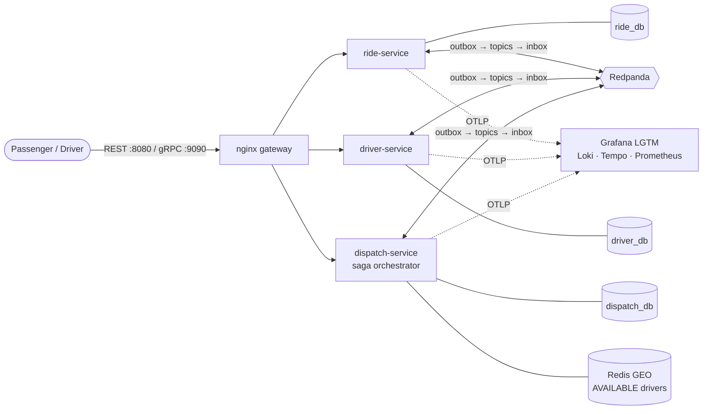
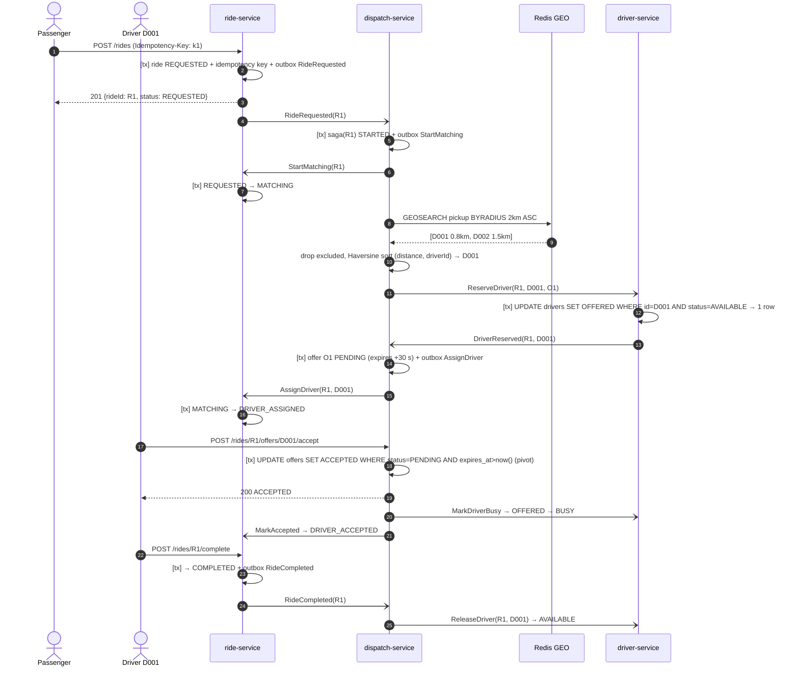
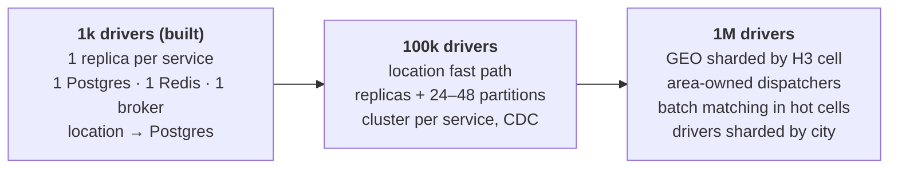
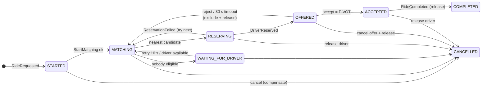
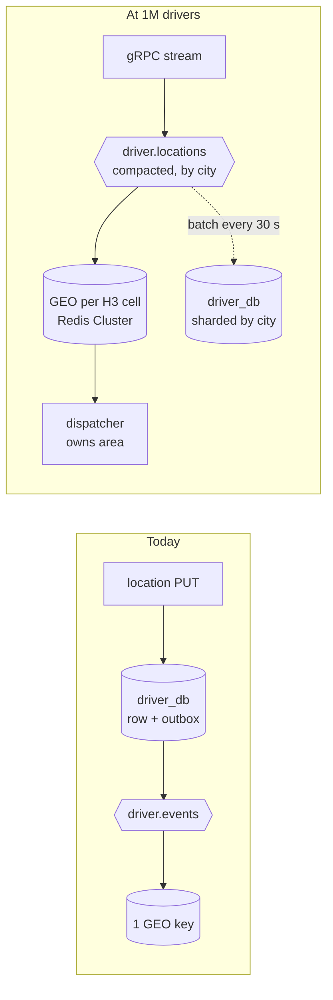

# 🚕 KVP: Ride-Hailing Dispatch Service

> Coding Challenge #3 · Team KVP (Khoa · Vinh · Phuong)
>
> *Finding the nearest driver is easy. Keeping every state correct while many requests and events run at the same time is the real challenge.*

**Agenda**

1. [Team introduction](#1-team-introduction)
2. [The problem](#2-the-problem-coding-challenge-3)
3. [Architecture: what we built](#3-architecture-what-we-built-to-solve-it)
4. [How to run and test](#4-how-to-run-and-how-to-test)
5. [Happy path scenario](#5-happy-path-scenario)
6. [Scale](#6-scale-from-1k-to-1m-drivers)
7. [Bonus: what we added](#7-bonus-what-we-added-and-why)
8. [Bottlenecks, strategies, trade-offs](#8-3-bottlenecks--3-scaling-strategies--2-trade-offs)
9. [What we learned, discussion, conclusion](#9-what-we-learned-discussion-and-conclusion)

---

## 1. Team introduction

<p align="center">
  
</p>

**KVP: Three Minds, Thousands of Debates, One Mission 🏆**

| Member | Role | Contact |
|---|---|---|
| **Khoa Phan** | Developer | khoa.phan@thoughtworks.com |
| **Victor Nguyen** | Developer | victor.nguyen@thoughtworks.com |
| **Duy Phuong Nguyen** | Developer | phuong.nguyen@thoughtworks.com |

What we set out to do as a team:

* Meet **all 10 acceptance criteria**, each traced to code and tests.
* Use the challenge to **practise distributed-system patterns** (saga, outbox/inbox, atomic reservation, tracing), even though a modular monolith was allowed.
* Explain **why** behind every choice: 12 ADRs, C4 diagrams, 8 sequence flows.

---

## 2. The problem: Coding Challenge #3

Build a simplified **ride-hailing dispatch service**: passengers request rides, the system offers each ride to a nearby driver, and the driver accepts or rejects.

```
Passenger ──Request Ride──► Ride Service ──Find nearby drivers──► Dispatch ──Offer──► Driver
                                                                                       │
                                                       Ride Accepted ◄──── Accept ─────┤
                                         Find another driver (rematch) ◄── Reject ─────┘
```

### What the system must do

1. Receive a ride request (with an `Idempotency-Key`).
2. Find the **nearest available driver within 2 km** (ties → smallest `driverId`).
3. Offer the ride; the driver **accepts or rejects** within **30 s**.
4. On reject/timeout, **rematch**, never offering the same ride to that driver again.
5. **Never assign one driver to two rides** at the same time.
6. Handle **duplicate requests and events** safely.
7. Keep a **valid lifecycle** for rides and drivers.

### The two state machines

```
Ride:    REQUESTED ─► MATCHING ─► DRIVER_ASSIGNED ─► DRIVER_ACCEPTED ─► COMPLETED
                         ▲               │
                         └── reject / ───┘          (any non-terminal) ─► CANCELLED
                             timeout

Driver:  OFFLINE ⇄ AVAILABLE ─offer─► OFFERED ─accept─► BUSY ─complete─► AVAILABLE
                       ▲                 │
                       └─ reject/cancel ─┘
```

### The three hard parts

| Hard part | Why it is hard | Acceptance criteria |
|---|---|---|
| **Nearest matching** | Must use the latest location, exclude rejected drivers, stay fast as the fleet grows | AC-03, AC-04, AC-07 |
| **Lifecycle across components** | Ride, driver and offer must change together, with a timer, a loop and cancellations | AC-05, AC-06, AC-10 |
| **Concurrency & duplicates** | Two rides can pick the same driver; accept can race timeout; messages arrive twice | AC-08, AC-09 |

Scoring: Acceptance Criteria 35 · Architecture 20 · Distributed Systems & Concurrency 15 · Testing 15 · Scalability 5 · Observability 5 · Docs 5.

---

## 3. Architecture: what we built to solve it

**Three Go microservices**, one per aggregate, each with **its own database**, coordinated by an **orchestrated saga** over **Redpanda** (Kafka API). **PostgreSQL** is the source of truth, **Redis GEO** finds nearby drivers, **OpenTelemetry → Grafana** gives logs, traces and metrics. One command starts all 10 containers.



| Service | Owns | Solves |
|---|---|---|
| **ride-service** | Rides, passengers, idempotency keys, ride state machine, history | AC-01, AC-06, AC-08 |
| **driver-service** | Driver status + location, driver state machine, the **atomic reservation** | AC-02, AC-03, AC-09 |
| **dispatch-service** | Saga, offers, exclusions, 30 s timeouts, matching, Redis GEO projection | AC-04, AC-05, AC-07, AC-10 |

### The core ideas in one sentence each

| Idea | What it means | Solves |
|---|---|---|
| **Orchestrated saga** | dispatch-service drives each ride with commands; before the driver accepts, every step can be undone (release driver, unassign ride) | Lifecycle across 3 services, rematch loop, timer, cancel |
| **Transactional outbox** | Messages are written in the *same* DB transaction as the state change, then relayed to Redpanda | No lost or phantom events |
| **Inbox** | Each consumer records `(consumer, event_id)` in its transaction; copies are skipped | Duplicate delivery |
| **Atomic reservation** | `UPDATE drivers … WHERE status='AVAILABLE'`; the row count decides the winner | One driver, one ride (AC-09) |
| **Redis suggests, Postgres decides** | Redis GEO returns candidates fast; Postgres confirms the pick | Fast *and* correct matching |
| **Clean Architecture** | domain → use cases (ports) → adapters, enforced by a test | Testable flows, swappable infrastructure |

### Inside each service

```
services/<ride|driver|dispatch>/
├── cmd/main.go           composition root: builds adapters, injects them into use cases
└── internal/
    ├── domain/           entities + rules: state machines, matching (pure Go, no I/O)
    ├── usecase/          application logic + ports.go (interfaces for DB, outbox, …)
    └── adapter/          http · grpc · messaging (Kafka) · postgres · redis · driverclient
```

### How each acceptance criterion is met

| AC | Requirement | How | Key proof |
|---|---|---|---|
| 01 | Create ride | `POST /rides` → `REQUESTED`, UUIDv7, validation, `Idempotency-Key` stored with the response | `TestConcurrentDuplicateCreationCreatesOneRide` |
| 02 | Driver availability | `OFFLINE ⇄ AVAILABLE`; `OFFERED`/`BUSY` cannot go offline | `TestDriverStatusLifecycle` |
| 03 | Driver location | Versioned events keep the GEO index on the latest location | `TestIndexKeepsOnlyLatestAvailableDrivers` |
| 04 | Matching | Nearest `AVAILABLE` within 2 km, Haversine, tie → smallest id | `TestEquidistantPicksSmallestDriverID` |
| 05 | Ride offer | Offer `PENDING` 30 s; only the offered driver can answer | `TestOnlyTheOfferedDriverCanRespond`, `TestOfferTimeoutRematches` |
| 06 | State machine | Pure, table-driven; invalid → `409`; duplicates are no-ops | `TestInvalidTransitions` |
| 07 | Rematching | Permanent per-ride exclusions | `TestRejectionRematchesAndExcludesTheDriverForever` |
| 08 | Idempotency | Idempotency key, inbox, saga PK, idempotent state machines | `TestDuplicateRideRequestedStartsOneSaga` |
| 09 | Concurrency | Atomic conditional update + partial unique indexes | `TestConcurrentReservationOnlyOneWins` (50 rounds) |
| 10 | Event-driven | Outbox → Redpanda → saga; retries, DLQ, resume | `TestHappyPath`, crash drill |

Full mapping: [requirements-traceability.md](../docs/requirements-traceability.md).

---

## 4. How to run and how to test

### Run

```bash
# one-time (macOS)
brew install colima docker docker-compose docker-buildx lazydocker go jq
colima start --cpu 4 --memory 8 --vm-type vz --vz-rosetta

cd coding-challenge-3/kvp
make up          # build + start 10 containers, waits until healthy
make demo        # request → reject → rematch → accept → complete, duplicates, a race
make down        # stop (make clean also deletes data)
```

| Open | What |
|---|---|
| http://localhost:8080 | REST API v1 (gateway) |
| http://localhost:8080/docs/ | Swagger UI with "Try it out" |
| localhost:9090 | gRPC API v2 (location stream, offer push) |
| http://localhost:3000 | Grafana → *Dispatch overview* (logs, traces, metrics) |
| http://localhost:8088 | Redpanda Console (topics, messages, consumer groups) |

Seeded data: passengers `P001–P010`; drivers `D001–D010` `AVAILABLE` ~220 m apart near Ben Thanh market (HCMC); `D011–D020` `OFFLINE`.

### Test

| Command | What runs | Count | Time |
|---|---|---|---|
| `make lint` | golangci-lint (8 linters + 2 formatters) + OpenAPI lint | — | ~10 s |
| `make test` | Unit (state machines, matching, use cases with fakes) + architecture rules | 32 | < 2 s |
| `make test-int` | Integration on **real Postgres 18 / Redis 8** (testcontainers) | 23 | ~15 s |
| `make test-e2e` | End-to-end through the gateway: REST, gRPC, OpenAPI contract, real 30 s timeout | 12 | ~40 s |
| `make postman` | Postman via newman: happy path + one folder per AC | 56 requests / 115 checks | ~40 s |

**CI:** GitHub Actions runs `lint` and `test` in parallel on every push, then starts the whole stack in Docker for e2e + Postman.

### Investigate a ride

```bash
make trace-ride RIDE=<rideId>     # the ride's state changes from all services, in order + Tempo link
make trace-logs TRACE=<traceId>   # every log line of the journey, with bodies and message values
```

---

## 5. Happy path scenario

### The story

> Passenger **P001** at Ben Thanh market requests a ride to Tan Son Nhat. Driver **D001** is 0.8 km away, **D002** 1.5 km, **D003** 3.2 km. The system offers the ride to D001 (nearest, inside 2 km). D001 accepts, drives, and completes the trip. D001 becomes available again.

### Run it

```bash
# 1. passenger requests a ride
curl -s -X POST localhost:8080/rides -H 'Idempotency-Key: k1' \
  -d '{"passengerId":"P001","pickup":{"latitude":10.7769,"longitude":106.7009},
       "destination":{"latitude":10.8231,"longitude":106.6297}}'
# → 201 {"rideId":"<R1>","status":"REQUESTED"}

# 2. a moment later the ride is offered to the nearest driver
curl -s localhost:8080/rides/<R1>                  # → DRIVER_ASSIGNED, assignedDriverId D001

# 3. driver sees and accepts the offer
curl -s localhost:8080/drivers/D001/offer          # → {offerId, rideId, expiresAt}
curl -s -X POST localhost:8080/rides/<R1>/offers/D001/accept   # → 200 ACCEPTED

# 4. trip completes
curl -s -X POST localhost:8080/rides/<R1>/complete # → COMPLETED, D001 AVAILABLE again

# 5. what happened?
make trace-ride RIDE=<R1>
```

### State over time

| Step | Ride | Driver D001 | Offer | Who changes it |
|---|---|---|---|---|
| 1. Request | `REQUESTED` | `AVAILABLE` | — | ride-service |
| 2. Saga starts | `MATCHING` | `AVAILABLE` | — | ride-service (command from saga) |
| 3. Reserve driver | `MATCHING` | **`OFFERED`** | — | driver-service (atomic update) |
| 4. Offer created | **`DRIVER_ASSIGNED`** (D001) | `OFFERED` | `PENDING` (30 s) | dispatch + ride-service |
| 5. Accept (pivot) | `DRIVER_ACCEPTED` | **`BUSY`** | `ACCEPTED` | dispatch, then ride + driver |
| 6. Complete | **`COMPLETED`** | **`AVAILABLE`** | — | ride-service, then driver |

### Flow



`[tx]` = one Postgres transaction that also writes the inbox and outbox rows. Every arrow between services goes through Redpanda.

### How we solve each step

| Step | Problem | Our solution |
|---|---|---|
| Request | Client retries or double-clicks | Idempotency key row inserted **first**, in the ride's transaction, with a request hash and the stored response. Same key → same ride (`Idempotent-Replayed: true`); same key + different body → `422` |
| Hand-off to dispatch | DB write succeeds but the event is lost (dual write) | Transactional **outbox**: the event commits with the ride; a relay publishes it |
| Saga start | `RideRequested` delivered 3× | **Inbox** skips copies; the saga's primary key is `rideId`, so there is only ever one saga |
| Matching | Find nearest fast, with latest location | Redis GEO set of `AVAILABLE` drivers, kept current by **versioned** events; Haversine re-check + tie-break in a pure Go function |
| Reserve | Two rides pick the same driver at once | One **conditional `UPDATE`**; the loser gets 0 rows → `DriverReservationFailed` → tries the next driver |
| Accept | Accept races timeout, reject or cancel | `UPDATE offers … WHERE status='PENDING' AND expires_at > now()`: exactly one wins. A repeated accept returns `200` with no new commands |
| After accept | Ride and driver must follow | The accept is the saga's **pivot**: before it everything can be compensated, after it steps are only retried until they succeed |
| Complete | Late messages must not free the wrong driver | `ReleaseDriver` carries `rideId`; it only applies `WHERE current_ride_id = R1` |

If D001 **rejects** or the **30 s timer** fires instead, D001 is excluded from R1 forever, released to `AVAILABLE`, the ride goes back to `MATCHING`, and the saga offers it to D002. If nobody is left, the ride waits in `MATCHING` and is retried every 10 s and whenever a driver becomes available.

---

## 6. Scale: from 1k to 1M drivers

The built system targets **1,000 drivers**. Larger scales are design, not built.

### Load model

Assumptions: a location update every **4 s** per online driver, ~0.6 rides/driver/hour at peak, ~1.5 offers per ride, ~12 messages per saga.

| | 1,000 drivers | 100,000 drivers | 1,000,000 drivers |
|---|---|---|---|
| Location updates | 250 /s | 25,000 /s | **250,000 /s** |
| Ride requests (peak) | 0.2 /s | 17 /s | ~170 /s (bursts ~500 /s) |
| Offers | 0.3 /s | 25 /s | ~250 /s |
| Saga messages | ~3 /s | ~200 /s | ~2,000 /s |
| Redis GEO memory (~120 B/driver) | 120 KB | 12 MB | ~120 MB |

> **Key insight:** location traffic grows to 250k writes/s while dispatch stays below ~1k/s. Scaling this system is about **ingesting locations and querying the geo index**, not about rides. That is why driver-service (the location path) is its own service.

### Evolution path



### The seven topics the challenge asks about

| Topic | 1k (built) | 100k | 1M |
|---|---|---|---|
| **Location storage** | `UPDATE drivers` + outbox event per update | Compacted topic `driver.locations.v1`; batched Postgres snapshot every 30 s | Same, partitioned by city |
| **Matching** | `GEOSEARCH` on one key, sub-ms | Same; ~25k `GEOADD`/s on one Redis primary | One GEO key per **H3 cell** (res 7, ~5 km²); search pickup cell + neighbours |
| **Database** | One Postgres server, 3 databases | Cluster per service, read replicas, `rides` partitioned by month | `driver_db` sharded by city; reservation stays a single-row update |
| **Broker** | 1 Redpanda node, 6 partitions/topic | 3 nodes, RF=3, 24–48 partitions | More nodes, 100+ partitions for location, tiered storage |
| **Dispatch workers** | 1 instance; sweepers use `SKIP LOCKED` (replica-safe) | N replicas, sagas spread by `rideId` | Partition dispatch by **area**: one owner per area |
| **Caching** | Not needed (Redis is a read model) | `GET /rides/{id}` cached ~1 s | Push (SSE/WebSocket/gRPC) instead of polling |
| **Partitioning** | Keyed by `rideId`/`driverId` (order per aggregate) | More partitions, same keys | Partition by **geography** so one area's data and work live together |

---

## 7. Bonus: what we added and why

Ten things beyond the acceptance criteria. For each: the options, how they compare, and what we chose.

### 7.1 Redis GEOSEARCH for matching (Geohash vs H3 vs PostGIS)

**The problem:** "Find the nearest `AVAILABLE` driver within 2 km" must be fast at any fleet size. Scanning every driver and computing Haversine is O(N) per ride. We need a **spatial index**.

There are three common ways to index locations:

#### Option A: Geohash grid (what Redis GEO uses)

Geohash splits the world into a grid of **squares** by interleaving latitude and longitude bits into one number. Nearby points usually share a prefix. Redis stores each member as a 52-bit geohash used as a **sorted-set score** (~0.6 m precision).

`GEOSEARCH … BYRADIUS 2 km` works like this:

```
   ┌─────┬─────┬─────┐
   │  NW │  N  │  NE │     1. pick a geohash precision whose cell is ≥ the radius
   ├─────┼─────┼─────┤     2. take the center cell + its 8 neighbours (9 boxes)
   │  W  │  ●  │  E  │     3. each box = one score range in the sorted set → range scans
   ├─────┼─────┼─────┤     4. compute exact distance, drop points outside the circle
   │  SW │  S  │  SE │     5. sort ASC, return with distance/coordinates
   └─────┴─────┴─────┘
        ● = pickup, ◯ = 2 km circle inside the 9 boxes
```

Cost depends on **drivers near the pickup**, not on fleet size.

#### Option B: H3 hexagonal grid (Uber)

H3 covers the Earth with **hexagons** at 16 resolutions (res 7 ≈ 5.2 km², res 8 ≈ 0.74 km², res 9 ≈ 0.1 km²). Each cell has a 64-bit id; `gridDisk(cell, k)` returns the cell and its rings of neighbours.

```
   Square grid (geohash)              Hexagon grid (H3)

   ┌───┬───┬───┐                         ⬡   ⬡
   │ d │ e │ d │   e = edge neighbour  ⬡   ●   ⬡     all 6 neighbours
   ├───┼───┼───┤   d = corner          ⬡   ⬡         are the SAME distance
   │ e │ ● │ e │       neighbour,                     from the center
   ├───┼───┼───┤       √2 ≈ 1.41× farther
   │ d │ e │ d │
   └───┴───┴───┘   8 neighbours, 2 distances
```

Why Uber built it: hexagons have **one neighbour distance**, so "ring k" is a good approximation of a circle; cells are similar in size and shape; and cells are a natural **unit for sharding and analytics** (supply/demand per cell, surge pricing). Geohash squares also have **edge effects**: two points a metre apart can sit in cells with very different prefixes, which is why Redis always checks the 8 neighbours.

#### Option C: PostGIS in Postgres

`ST_DWithin` + a GiST/KNN index on the `drivers` table. Always fresh, same database, no projection to maintain.

#### Comparison

| | Redis GEO (geohash) | H3 cells (+ Redis per cell) | PostGIS |
|---|---|---|---|
| Query | `GEOSEARCH BYRADIUS ASC`, built in | Look up pickup cell + `gridDisk` ring, then query each cell | `ST_DWithin` + KNN `<->` |
| Speed | In memory, sub-ms | In memory, sub-ms | ms, on disk/buffer cache |
| Freshness | Eventually consistent (fed by events) | Eventually consistent | Always fresh |
| Write load | Location writes never touch reservation rows | Same | Every update churns the DB that decides reservations |
| Sharding | One key per set; cannot split one key across a cluster | **Natural**: one key per cell, spread over a cluster | Shard by city |
| Neighbour shape | Squares, 2 neighbour distances | Hexagons, uniform | Exact distance |
| Complexity | Lowest: one command | Library + cell bookkeeping + border queries | Extension + index tuning |
| Best at | Up to a few 100k drivers in one set | 1M+ drivers, city/cell partitioning | Small fleets, one database |

#### What we chose

* **Now (1k–100k): Redis GEO.** Simplest, sub-ms, and keeps the 250k/s location stream away from the Postgres rows that guarantee correctness.
* **At 1M: H3 on top of Redis GEO.** One GEO key per H3 cell (res 7), spread across a Redis Cluster; query the pickup cell and its ring-1 neighbours. The same cells partition dispatch by area. ([scalability S2](../docs/scalability.md#5-scaling-strategies))
* **Redis is only a hint.** driver-service confirms the pick with the atomic update. A stale index costs one retry, never a wrong assignment.

How we keep the index correct ([projection.go](../services/dispatch/internal/usecase/projection.go)):

```
driver-service ──DriverStatusChanged / LocationUpdated (version N)──► dispatch projector
                                                                         │ Lua script, atomic:
                                                                         │ if N > stored.version:
                                                                         │   AVAILABLE → GEOADD
                                                                         │   otherwise → ZREM
                                                                         ▼
                                              geo:drivers:available  +  driver:{id} {status,lat,lng,version}
```

Old and duplicate events are ignored by version, so matching always uses the **latest** location (AC-03). `GEOSEARCH` returns `20 + |excluded|` candidates, widened if a tie is cut off, then the pure function `SelectNearest` applies exclusions, Haversine, radius and tie-break, fully unit-tested without Redis.

References: [Redis geospatial docs](https://redis.io/docs/latest/develop/data-types/geospatial/) · [Uber: H3 hexagonal hierarchical spatial index](https://www.uber.com/blog/h3/) · [h3geo.org](https://h3geo.org/) · [ADR-001](../docs/adr/ADR-001-matching.md)

---

### 7.2 Saga orchestration (vs 2PC vs choreography vs Temporal)

**The problem:** one dispatch changes three aggregates in three databases: **ride**, **driver**, **offer**. The flow has a **loop** (rematch), a **timer** (30 s) and **compensations** (release driver, unassign ride), plus cancellation at any time.

| Option | How it works | Pros | Cons | Verdict |
|---|---|---|---|---|
| Two-phase commit | A coordinator locks all databases, then commits | Atomic | Blocking; a coordinator crash leaves locks; Kafka can't take part | ❌ |
| Choreography | Services react to each other's events | No central service | The loop, timer and exclusions have no owner; "what happened to R1?" needs many streams | ❌ |
| **Orchestration, hand-rolled** | dispatch-service sends commands and reacts to replies; state in Postgres | One owner of the flow; every step visible in SQL, logs and one trace; no extra infra | We write timers, retries and resume ourselves | ✅ **Chosen** |
| Temporal | Durable workflows as code | Timers, retries, history built in | Another cluster to run; hides the mechanics we were asked to explain | Future, when more workflows appear |



**Pivot:** before accept, every step has a compensation. After accept, steps are only retried until they succeed. Background workers expire offers (`SKIP LOCKED`), retry waiting rides and **resume** stuck sagas after 30 s. ([ADR-003](../docs/adr/ADR-003-saga-orchestration.md), [patterns P1](../docs/patterns.md#p1-saga-orchestration-with-compensations-and-a-pivot))

---

### 7.3 Concurrency control with database guarantees (vs distributed locks)

**The race:** two sagas read Redis at the same moment and both pick D001. "Read status, check `AVAILABLE`, then write" lets both succeed.

```
Saga R1: GEOSEARCH → D001 ┐
                          ├─► both send ReserveDriver(D001)
Saga R2: GEOSEARCH → D001 ┘

driver-service:
  UPDATE drivers SET status='OFFERED', current_ride_id=R1 WHERE id='D001' AND status='AVAILABLE'  → 1 row ✔
  UPDATE drivers SET status='OFFERED', current_ride_id=R2 WHERE id='D001' AND status='AVAILABLE'  → 0 rows ✘
  → R2 gets DriverReservationFailed, tries D002
```

| Option | Pros | Cons | Verdict |
|---|---|---|---|
| **Atomic conditional `UPDATE … WHERE status=…`** | One statement; row count = answer; correct across replicas and crashes; no extra infra | The driver row is a serialisation point | ✅ **Chosen** |
| Distributed lock (Redis `SET NX` / Redlock) | Familiar | A lease can expire during a GC pause or network delay → two holders, unless the DB re-checks anyway | ❌ |
| Optimistic version check | Works | Same idea, more code | Used for rides (`version`) |

The same pattern decides **every** race: accept vs reject vs timeout vs cancel (`WHERE status='PENDING'`), late releases (`WHERE current_ride_id=$ride`), ride transitions (`SELECT … FOR UPDATE`). Lock order is always saga → offer, so no deadlocks. **Defence in depth:** partial unique indexes (one `PENDING` offer per driver and per ride) and a `CHECK` constraint on drivers.

**Proof:** 50 rounds of two goroutines behind a barrier on real Postgres; exactly one wins every round. ([ADR-002](../docs/adr/ADR-002-concurrency.md))

---

### 7.4 Reliable messaging: outbox + inbox (vs "exactly-once")

**The dual-write problem:** writing to Postgres and then publishing to Kafka can half-fail: the DB commits but the event is lost (stuck ride), or the event goes out but the DB rolls back (phantom event).

```
 ┌──────────── one Postgres transaction ────────────┐
 │ INSERT inbox(consumer, event_id) ON CONFLICT ─► 0 rows? skip (duplicate)
 │ UPDATE business row (state machine)              │
 │ INSERT outbox(message, traceparent)              │
 └───────────────────────────────────────────────────┘
          │ relay polls every 50 ms, publishes in id order (acks=all)
          ▼
      Redpanda topic (keyed by rideId / driverId) ──► next consumer (same pattern)
```

| Option | Verdict | Why |
|---|---|---|
| **At-least-once + idempotent consumers (inbox)** | ✅ Chosen | No loss, works with any broker, crash-safe |
| Kafka "exactly-once" transactions | ❌ | Only covers Kafka; the Postgres write is outside it, so dedup is still needed |
| Outbox + CDC (Debezium) | Future | Lower latency at volume, but needs Kafka Connect |

**If a message arrives twice:** the inbox insert conflicts → skipped. **If processing fails:** the transaction rolls back, the offset isn't committed, retry 5× (100 ms → 5 s, with jitter), then `<topic>.dlq` + `ERROR` log; `make replay-dlq`. A killed service catches up from Redpanda after restart (tested with a kill/restart drill). ([ADR-004](../docs/adr/ADR-004-messaging-outbox-inbox.md))

---

### 7.5 Redpanda instead of Kafka

| Option | Pros | Cons | Verdict |
|---|---|---|---|
| **Redpanda** | Kafka API (same client code); one C++ binary, no JVM or ZooKeeper; starts in seconds; `rpk` + Console | Smaller community | ✅ **Chosen** |
| Apache Kafka (KRaft) | The standard, biggest ecosystem | JVM heap, heavier on a laptop | Switching = change `KAFKA_BROKERS` |
| RabbitMQ | Simple queues, delayed messages | No replayable, partitioned log | ❌ |

We needed **per-key ordering**, **retention + replay** (catch up after restart, rebuild projections, DLQ) and **consumer groups**. Kafka semantics give all three. Kafka has no delayed messages, so the 30 s offer timeout lives in Postgres (`offers.expires_at` + a sweeper) and survives restarts. ([ADR-009](../docs/adr/ADR-009-message-broker.md))

---

### 7.6 Partitioning to keep messages in order

Topics are keyed by **`rideId`** (ride topics, replies) and **`driverId`** (driver topics). Every message about one ride lands on one partition, in order, while services scale out by partition.

```
ride.events.v1  (6 partitions)
  P0: R7 Requested → R7 Assigned → R7 Accepted     ← one consumer, in order
  P1: R2 Requested → R9 Requested → R2 Cancelled
  ...
consumer group "dispatch": instance A owns P0–P2, instance B owns P3–P5
```

The outbox relay publishes in `outbox.id` order, and the inbox removes duplicates. Topics: `ride.events.v1`, `driver.events.v1`, `ride.commands.v1`, `driver.commands.v1`, `dispatch.replies.v1`, each with a `.dlq`.

---

### 7.7 Microservices with Clean Architecture (vs modular monolith)

| Option | Pros | Cons | Verdict |
|---|---|---|---|
| Modular monolith | One transaction, simplest to run, enough for 1k drivers | No independent scaling; doesn't meet our learning goal | The right default without that goal |
| **3 microservices, DB per service** | The location path scales on its own; practice with sagas, idempotent messaging, tracing | Eventual consistency; more infrastructure; over the timebox | ✅ **Chosen**, deliberately |

We kept the cost low: only **three** services (one per aggregate), one shared bootstrap package, one Compose file, one **nginx gateway** so clients never see three services. Database users enforce ownership, so each DB can move to its own cluster without code changes.

Inside each service, **Clean Architecture** with a test (`test/arch`) that fails if `domain` imports infrastructure or adapters import each other. Result: all flows are unit-testable with fakes, and the atomic SQL lives in one adapter. ([ADR-006](../docs/adr/ADR-006-service-architecture.md), [ADR-012](../docs/adr/ADR-012-clean-architecture.md))

---

### 7.8 Go, with gRPC streams for the driver app

**Go** (standard library first): ~20 MB images, millisecond start-up, goroutines for every consumer loop and worker. ([ADR-007](../docs/adr/ADR-007-language-and-libraries.md))

Next to REST v1, the two **highest-frequency driver calls** are also gRPC v2 streams:

| v2 RPC | Replaces | Why a stream |
|---|---|---|
| `DriverLocationService/StreamLocations` | `PUT /drivers/{id}/location` every few seconds | One long connection instead of one HTTP request per update; each update acknowledged. This is the first step of the location fast path (S1) |
| `OfferService/WatchOffers` | Polling `GET /drivers/{id}/offer` | Offers are **pushed** (`OFFERED`, then `CLOSED`) |

Both call the same use cases as REST. Try: `make grpc-offers DRIVER=D001` and request a ride in another terminal. ([ADR-010 Part 6](../docs/adr/ADR-010-api-and-identifiers.md#part-6-grpc-api-v2-for-two-driver-app-apis))

---

### 7.9 Observability: one trace per ride

**"What happened to ride R001?"** must be answerable from logs (challenge requirement).

* **Logs:** `key=value` lines; every line carries `ride_id`, `driver_id`, `event_id`, `causation_id`, `trace_id`. HTTP bodies and every produced/consumed message are logged.
* **Traces:** the ride's `traceparent` is **stored** with the saga, so every later step (offers, rejections, a timeout 30 s later, acceptance, completion) joins **one trace** across all services and Redpanda.
* **Metrics:** offers by outcome, time to first offer, reservation conflicts, outbox backlog, consumer outcomes, HTTP latency, on a provisioned Grafana dashboard.
* **Stack:** OpenTelemetry → Grafana LGTM (Loki, Tempo, Prometheus) in one container. Vendor-neutral.

([ADR-005](../docs/adr/ADR-005-observability.md), [observability.md](../docs/observability.md))

---

### 7.10 Tests at every level, CI and documentation

```
            ▲  Postman / newman: 56 requests, 115 checks (one folder per AC)
           ▲▲  E2E: 12 (REST + gRPC through nginx, OpenAPI contract, real 30 s timeout)
         ▲▲▲▲  Integration: 23 (real Postgres 18 / Redis 8 via testcontainers)
     ▲▲▲▲▲▲▲▲  Unit + architecture: 32 (state machines, matching, use cases with fakes)
```

* AC-09 is proven on a **real database**, not a mock: an in-memory fake can't show row-lock behaviour.
* **CI:** GitHub Actions: `lint` ∥ `test` → full stack in Docker → e2e + Postman (5 s timeout), container logs uploaded on failure.
* **Docs:** C4 architecture, 8 sequence diagrams, 14 design patterns, 12 ADRs, requirement → code → test traceability, OpenAPI with Swagger UI.

---

## 8. 3 bottlenecks · 3 scaling strategies · 2 trade-offs

(The full analysis has 6 bottlenecks, 6 strategies and 5 trade-offs: [scalability.md](../docs/scalability.md).)

### 3 potential bottlenecks

| # | Bottleneck | Why it breaks | Breaks at | How we'd see it |
|---|---|---|---|---|
| **B1** | **Location writes on `driver_db`** | Every update is a Postgres `UPDATE` + outbox row. One primary handles ~10–20k such writes/s; 1M drivers need **250k/s** | ~50–100k drivers | `driver_db` write p99 > 50 ms, CPU > 70 %, outbox backlog |
| **B2** | **One Redis GEO key** | Redis runs each shard on one core; a single key can't be split across a cluster | a few 100k drivers | Redis CPU > 60 %, `GEOSEARCH` p99 > 5 ms, projector lag |
| **B3** | **Hot zones** (airport, stadium) | Many rides chase the same nearest drivers → reservation conflicts and retries. More servers don't help: the contention is on the data | any scale, locally | conflicts / offers > 20 % in an area |

### 3 scaling strategies

| # | Strategy | Fixes | What it does | Cost |
|---|---|---|---|---|
| **S1** | **Location fast path** | B1 | Drivers stream locations over gRPC (built). Location goes to a **compacted Redpanda topic**, not a Postgres row per update; snapshot to Postgres every 30 s. Status changes stay transactional | Up to 30 s of location history lost on a crash; the next update fixes it |
| **S2** | **Geo partitioning (H3) + area-owned dispatch** | B2, B3 | One GEO key per H3 cell across a Redis Cluster; ride events partitioned by area so **one dispatcher owns an area** and most conflicts disappear | Border rides query neighbour cells; rebalancing areas needs care |
| **S3** | **Horizontal scale of stateless services** | throughput | 3–N replicas per service, 24–48+ partitions, sagas spread by key; workers already use `SKIP LOCKED` | Relay ordering needs leader election or CDC |



### 2 architectural trade-offs

| # | We chose | Over | Gained | Paid | Revisit when |
|---|---|---|---|---|---|
| **T1** | **Microservices + saga** | Modular monolith | Independent scaling of the location path; clear ownership; hands-on with distributed patterns | Eventual consistency (ms); more infrastructure; well over the 4–6 h timebox | Scale stays < ~50k drivers and one team owns it |
| **T2** | **Redis GEO projection** (eventually consistent) | Querying Postgres per match | In-memory matching; no load on reservation rows; matching works if driver-service is slow | A candidate may be stale → one failed reservation, **never a wrong assignment**, because Postgres decides | Failed-reservation rate is high |

What we did **not** measure: we did not run load tests. The per-node limits above are typical published orders of magnitude, not measurements of this system. Next step: k6 scenarios for location ingestion and hot-zone contention.

---

## 9. What we learned, discussion and conclusion

### What we learned

1. **Correctness lives in the data owner, not in the cache.** "Redis suggests, Postgres decides" let us make matching fast *and* safe. A stale read costs a retry, never a bug.
2. **One atomic statement beats a lock service.** `UPDATE … WHERE status='AVAILABLE'` and its row count solved every race we found: two rides, accept vs timeout, late releases.
3. **At-least-once is a given; design for duplicates.** Outbox + inbox + idempotent state machines turned "what if this arrives twice?" into a non-issue at every layer.
4. **Sagas need a pivot.** Naming the point of no return (driver accepts) made compensation rules clear: undo before, retry after.
5. **The hard part is the edges, not the happy path.** Cancel during reserve, accept 1 ms before timeout, a reply lost in a crash: most of our tests and sequence diagrams are about these.
6. **Microservices have a real cost.** For 1k drivers a modular monolith would be enough. We paid in infrastructure, eventual consistency and time, and we learned exactly *where* that cost is worth it (the location path at 100k+).
7. **Write the ADR while deciding.** The 12 ADRs forced us to compare options honestly and made this presentation easy.
8. **Observability is a feature.** Storing the ride's trace context gave one trace per ride across services, minutes apart, which made debugging the saga much faster.

### Known limitations (honest list)

| Limitation | Next step |
|---|---|
| Accept returns at the pivot; the ride shows `DRIVER_ACCEPTED` a few ms later | Return the expected final state |
| A ride with no driver waits in `MATCHING` forever | Auto-cancel after a max wait |
| One outbox relay per instance; replicas could publish out of order | Leader election or CDC |
| No cleanup jobs for inbox/outbox/idempotency rows | Time-based deletes or partition drops |
| No authentication | JWT at the gateway, per-driver authorisation |
| Not load-tested | k6 scenarios |

### Discussion

* Would you start this as a **modular monolith** and extract the location path later? Where is the line?
* **Greedy nearest vs batch matching**: when does fleet-wide optimisation beat the simple rule the spec asks for?
* **Hand-rolled saga vs Temporal**: how many workflows before a workflow engine pays off?
* How would you **test the race conditions** that only show up under real load?

### Conclusion

| | |
|---|---|
| **Requirements** | All 10 ACs met, each traced to code and an automated test |
| **Correctness** | Every race decided by one atomic statement in the owning service; duplicates harmless at every layer |
| **Architecture** | 3 services, saga + outbox/inbox, Redis GEO + Postgres, one trace per ride |
| **Quality** | 32 unit + 23 integration + 12 e2e + 115 Postman checks, CI on every push |
| **Growth path** | Clear route from 1k to 1M drivers: location fast path → H3 geo partitioning → area-owned dispatch |

> **One mission:** a dispatch service that is small enough to run with `make up`, correct under concurrency and duplicates, and designed to grow. **Thank you! Questions?** 🙌

**Links:** [README](../README.md) · [Architecture](../docs/architecture.md) · [Sequence diagrams](../docs/sequence-diagram.md) · [Patterns](../docs/patterns.md) · [Scalability](../docs/scalability.md) · [ADRs](../docs/adr/README.md) · [Testing](../docs/testing.md)
