# 🚕 [Coding Challenge #3] KVP Team: Ride-Hailing Dispatch Service

**Agenda**

1. [Team introduction](#1-team-introduction)
2. [The problem](#2-the-problem)
3. [Architecture: what we built](#3-architecture-what-we-built)
4. [How to run and test](#4-how-to-run-and-test)
5. [🎬 Demo](#5--demo)
6. [Scalability](#6-scalability)
7. [How we solved each problem](#7-how-we-solved-each-problem)
8. [Bottlenecks, strategies, trade-offs](#8-3-bottlenecks--3-scaling-strategies--2-trade-offs)
9. [What we learned, discussion, conclusion](#9-what-we-learned-discussion-and-conclusion)

---

## 1. Team introduction

<p align="center">
  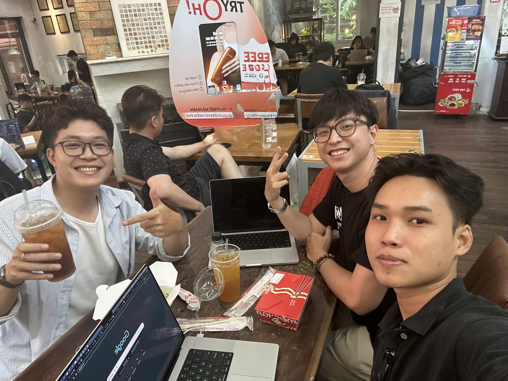
</p>

**KVP: Three Minds, Thousands of Debates, One Mission 🏆**

| Member | Role | Contact |
|---|---|---|
| **Khoa Phan** | Developer | khoa.phan@thoughtworks.com |
| **Victor Nguyen** | Developer | victor.nguyen@thoughtworks.com |
| **Duy Phuong Nguyen** | Developer | phuong.nguyen@thoughtworks.com |

### How we worked as a team

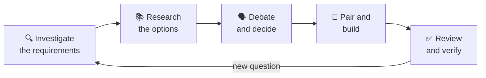

| Activity | What we did |
|---|---|
| 🔍 **Investigate the requirements** | Read the challenge line by line and turned every acceptance criterion into a checklist item. We listed the open questions (What happens to a rejected driver? What does "duplicate" mean for events, not only HTTP? What if a cancel and an accept arrive together?) and wrote down our assumptions instead of guessing silently. |
| 📚 **Research** | Before choosing, we each looked into a different area: how ride-hailing companies match drivers, spatial indexes, distributed transactions, message brokers, and how to prove a race condition in a test. We brought back options, not answers. |
| 🗣️ **Debate** | This is where the "thousands of debates" come from. Monolith or microservices? Redis or PostGIS? Choreography or orchestration? Lock or atomic update? Each debate ended with a written decision record (ADR) that says what we chose, what we gave up, and when we would change our mind. |
| 👥 **Pairing** | We paired on the risky parts (the saga, the concurrency guard, the outbox) so at least two people understood each of them. Smaller, well-understood tasks were done alone and reviewed. |
| 🗓️ **Meetings** | Short syncs to unblock and re-plan, and longer design sessions when a decision affected everyone. Every decision that came out of a meeting went into the docs the same day. |
| ✅ **Verify** | "Done" meant a test proves it, not "it works on my machine". Each acceptance criterion is traced to the code and to a test that fails if it breaks. Victor load-tested the system with k6 to find where it breaks. |

What we took away from working this way: **writing decisions down ended debates faster**, and pairing on the hard parts meant nobody owned a part of the system alone.

---

## 2. The problem

### 2.1 The story

> 📍 A passenger at the Opera House in Ho Chi Minh City taps **Request ride**.
> Five drivers are online nearby. Who gets the ride? What if that driver says no, or doesn't answer?
> What if two passengers want the same driver at the same moment? What if the phone sends the request three times?

We had to build the **dispatch service** behind that button: a small system that is **correct today** and can **grow** to a million drivers.

### 2.2 The flow

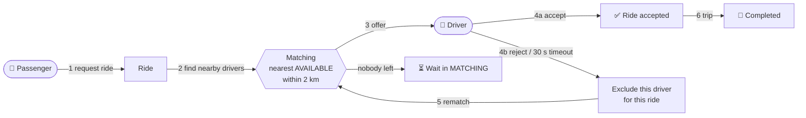

### 2.3 What the system must guarantee

| | Requirement | AC |
|---|---|---|
| 🆕 | Create a ride with an `Idempotency-Key`; validate passenger and coordinates | AC-01 |
| 🟢 | Drivers switch `OFFLINE ⇄ AVAILABLE`; busy drivers cannot | AC-02 |
| 📍 | Store the latest driver location; matching uses it | AC-03 |
| 🎯 | Nearest `AVAILABLE` driver within a configurable radius (2 km); ties → smallest `driverId` | AC-04 |
| 📨 | Offer the ride; only that driver answers; 30 s timeout = rejection | AC-05 |
| 🔁 | An explicit ride lifecycle: valid transitions pass, invalid ones fail, duplicates are harmless | AC-06 |
| 🚫 | A driver who rejects is never offered that ride again | AC-07 |
| ♻️ | Duplicate requests and events never create duplicate effects | AC-08 |
| 🔒 | One driver can never hold two rides at the same time | AC-09 |
| 📬 | Dispatch is asynchronous (event-driven) | AC-10 |

### 2.4 Two state machines

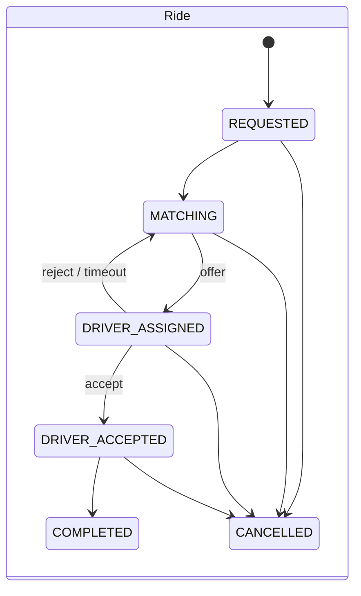

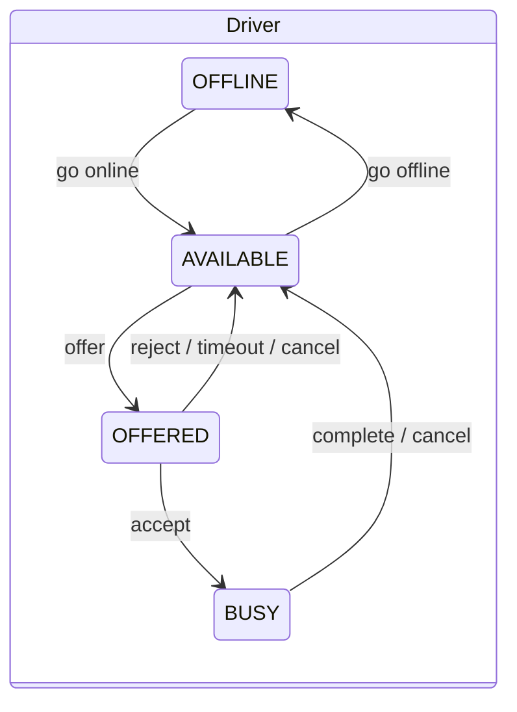

### 2.5 Why it is hard

| Hard part | Why |
|---|---|
| 🎯 **Matching** | Must use the latest location, skip excluded drivers and stay fast as the fleet grows |
| 🔗 **One lifecycle, many records** | Ride, driver and offer change together, with a loop (rematch), a timer (30 s) and cancellation at any time |
| ⚡ **Races and duplicates** | Two rides pick the same driver; accept races timeout; messages arrive twice |

> **Finding the nearest driver is the easy part. Keeping every state correct while requests and events run at the same time is the real challenge.**

Out of scope (as the challenge allows): payments, pricing, auth, registration, ETA, mobile apps, multi-region.

---

## 3. Architecture: what we built

### 3.1 The big picture

**Three Go services**, one per business area, each with **its own database**. They talk through **Redpanda** (Kafka API). **PostgreSQL** is the source of truth, **Redis** answers "who is nearby?" and holds the live dispatch config, and **OpenTelemetry → Grafana** shows logs, traces and metrics. `make up` starts all of it.

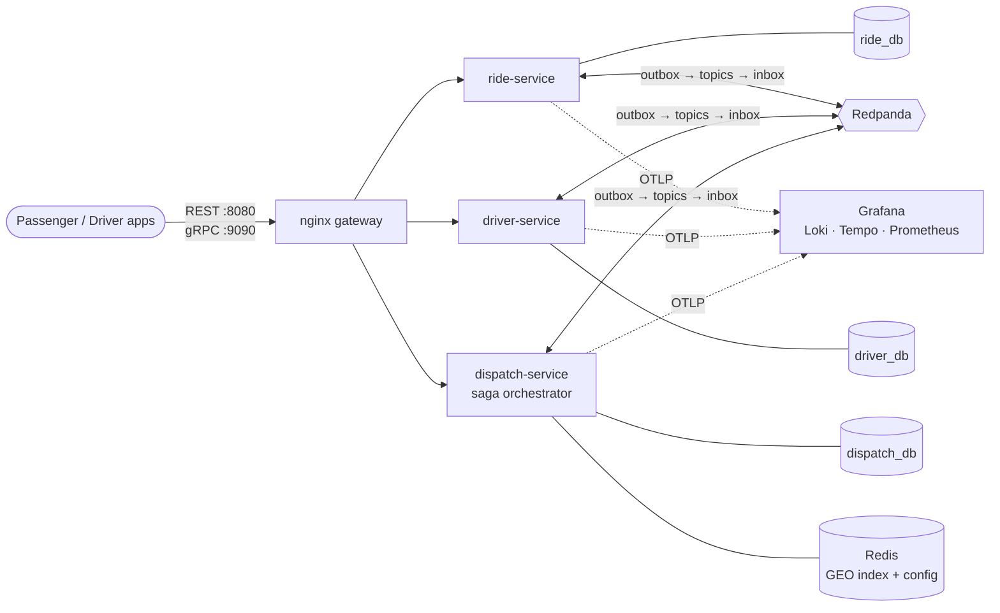

| Service | Owns | Main job | AC |
|---|---|---|---|
| **ride-service** | Rides, passengers, idempotency keys, ride history | The ride lifecycle | 01, 06, 08 |
| **driver-service** | Driver status and location | The **atomic reservation** of a driver | 02, 03, 09 |
| **dispatch-service** | Sagas, offers, exclusions, timeouts, GEO index, config | Matching and the whole dispatch flow | 04, 05, 07, 10 |

### 3.2 Five ideas that hold it together

| Idea | In one sentence |
|---|---|
| **Saga** | dispatch-service drives each ride step by step with commands; before the driver accepts, every step can be undone |
| **Outbox + inbox** | A state change and its messages are saved in one transaction; a consumer skips messages it has already handled |
| **Compare-and-set (CAS) in SQL** | `UPDATE … WHERE status='AVAILABLE'`: the number of changed rows decides who won |
| **Redis suggests, Postgres decides** | Redis finds nearby drivers fast; Postgres confirms the pick |
| **One trace per ride** | Every log line and span of a ride, across services and minutes, joins one trace |

### 3.3 Data model (ERD)

Three databases on one Postgres server locally, each with its own user, so a service can only touch its own data. There are **no foreign keys across databases**: services refer to each other's records by id and stay consistent through the saga.

**ride_db** (ride-service)

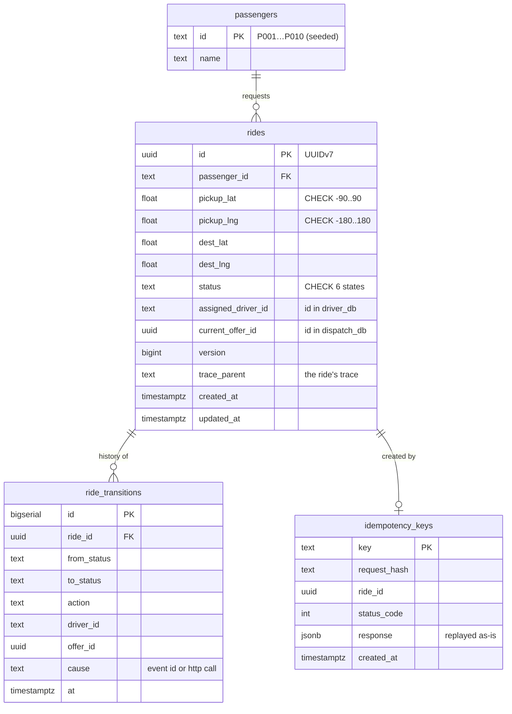

**driver_db** (driver-service)

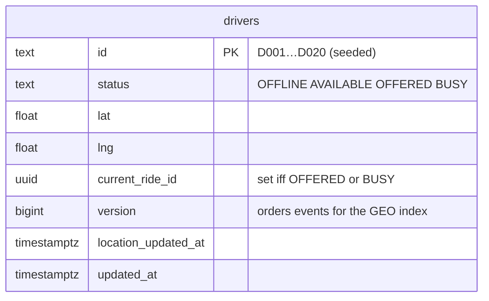

**dispatch_db** (dispatch-service)

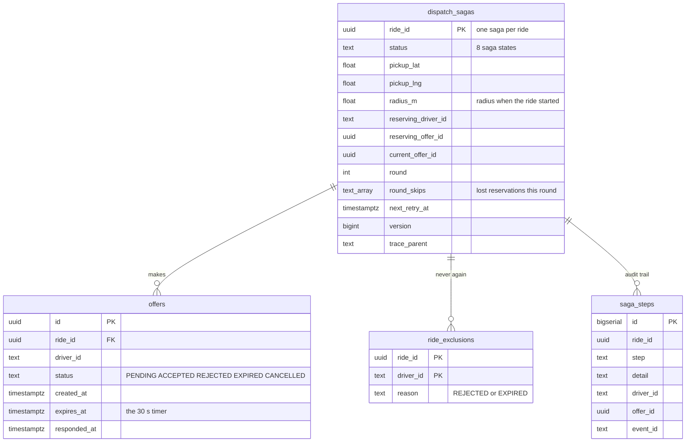

**In every database:** `outbox(id, topic, msg_key, event_id UNIQUE, type, envelope, headers, published_at)` and `inbox(consumer, event_id) PRIMARY KEY`.

### 3.4 Indexes and constraints: correctness lives in the schema

| Where | Index / constraint | Why it exists |
|---|---|---|
| `drivers` | `CHECK ((status IN ('OFFERED','BUSY')) = (current_ride_id IS NOT NULL))` | A driver who holds a ride always says which one; a free driver never does |
| `offers` | `UNIQUE (driver_id) WHERE status='PENDING'` | **At most one pending offer per driver** (AC-09, second line of defence) |
| `offers` | `UNIQUE (ride_id) WHERE status='PENDING'` | At most one pending offer per ride |
| `offers` | `(expires_at) WHERE status='PENDING'` | The timeout sweeper finds expired offers without scanning history |
| `offers` | `(ride_id, created_at)` | All offers of a ride, in order |
| `dispatch_sagas` | `PRIMARY KEY (ride_id)` | A duplicate `RideRequested` **cannot** start a second saga (AC-08) |
| `dispatch_sagas` | `(status, updated_at) WHERE status NOT IN ('COMPLETED','CANCELLED')` | The retrier only scans active sagas |
| `ride_exclusions` | `PRIMARY KEY (ride_id, driver_id)` | Exclusion is permanent and recorded once (AC-07) |
| `idempotency_keys` | `PRIMARY KEY (key)` | A concurrent duplicate `POST /rides` waits on the key, then replays (AC-01, AC-08) |
| `inbox` | `PRIMARY KEY (consumer, event_id)` | A redelivered message is skipped (AC-08, AC-10) |
| `outbox` | `(id) WHERE published_at IS NULL` | The relay reads only unpublished rows, in order |
| `outbox` | `UNIQUE (event_id)` | A message is stored once |
| `ride_transitions`, `saga_steps` | `(ride_id, id)` | "What happened to ride X?" in one indexed read |
| `rides` | `CHECK` on coordinates and status | Invalid data cannot be stored even by a bug |

### 3.5 Redis keys

| Key | Type | Content | Written by |
|---|---|---|---|
| `geo:drivers:available` | GEO (sorted set) | Only `AVAILABLE` drivers and their location | Projector, from driver events |
| `driver:{id}` | Hash | `status, lat, lng, version` (newer versions only) | Projector (Lua script) |
| `config:dispatch` | Hash | `match_radius_m`, `offer_timeout_s` | dispatch on start, `PUT /dispatch/config`, or `HSET` by hand |

### 3.6 Topics

| Topic | Key | Carries |
|---|---|---|
| `ride.events.v1` | `rideId` | RideRequested, RideCancelled, RideCompleted, … |
| `ride.commands.v1` | `rideId` | StartMatching, AssignDriver, UnassignDriver, MarkAccepted |
| `driver.commands.v1` | `driverId` | ReserveDriver, ReleaseDriver, MarkDriverBusy |
| `driver.events.v1` | `driverId` | DriverStatusChanged, DriverLocationUpdated (versioned) |
| `dispatch.replies.v1` | `rideId` | CommandSucceeded, CommandRejected, DriverReserved, DriverReservationFailed |
| `<topic>.dlq` | same | Messages that failed 5 times |

### 3.7 Inside each service

Clean Architecture: dependencies point inward, and a test fails the build if they don't.

```
services/<ride|driver|dispatch>/
├── cmd/main.go           wires adapters into use cases
└── internal/
    ├── domain/           state machines, matching, settings rules (pure Go, no I/O)
    ├── usecase/          application logic + ports.go (interfaces)
    └── adapter/          http · grpc · messaging · postgres · redis
```

### 3.8 Every acceptance criterion, traced

| AC | How | Proof (automated test) |
|---|---|---|
| 01 | `POST /rides` → `REQUESTED`, UUIDv7, validation, idempotency key stored with the response | `TestConcurrentDuplicateCreationCreatesOneRide` |
| 02 | `OFFLINE ⇄ AVAILABLE`; `OFFERED`/`BUSY` cannot go offline | `TestDriverStatusLifecycle` |
| 03 | Versioned events keep the GEO index on the latest location | `TestIndexKeepsOnlyLatestAvailableDrivers` |
| 04 | Nearest `AVAILABLE` within the live radius, Haversine, tie → smallest id | `TestEquidistantPicksSmallestDriverID` |
| 05 | Offer `PENDING` with the live timeout; only the offered driver answers | `TestOnlyTheOfferedDriverCanRespond`, `TestOfferTimeoutRematches` |
| 06 | Pure state machines; invalid → `409`; duplicates are no-ops | `TestInvalidTransitions` |
| 07 | Permanent per-ride exclusions | `TestRejectionRematchesAndExcludesTheDriverForever` |
| 08 | Idempotency key, inbox, saga PK, idempotent state machines | `TestDuplicateRideRequestedStartsOneSaga` |
| 09 | CAS update + partial unique indexes | `TestConcurrentReservationOnlyOneWins` (50 rounds) |
| 10 | Outbox → Redpanda → saga; retries, DLQ, resume | `TestHappyPath`, crash drill |

Full mapping: [requirements-traceability.md](../docs/requirements-traceability.md).

---

## 4. How to run and test

### Run

```bash
brew install colima docker docker-compose docker-buildx lazydocker go jq    # once
colima start --cpu 4 --memory 8 --vm-type vz --vz-rosetta

cd coding-challenge-3/kvp
make up          # build + start everything, waits until healthy
make demo-map    # the live map demo (section 5)
make demo        # the same story as a logged curl script
make down        # stop (make clean also deletes data)
```

| Open | What |
|---|---|
| http://localhost:8080/demo/ | **Live map demo** |
| http://localhost:8080/docs/ | Swagger UI with "Try it out" |
| http://localhost:3000 | Grafana: logs, traces, metrics, k6 dashboard |
| http://localhost:8088 | Redpanda Console: topics and messages |
| http://localhost:8089 · http://localhost:5540 | Database browser (Adminer) · RedisInsight |

### Change the radius and timeout at runtime

```bash
make config                              # {"matchRadiusM":2000,"offerTimeoutSeconds":30,"source":"redis",…}
make config-set RADIUS=1500 TIMEOUT=20   # stored in Redis config:dispatch, live within ~1 s
```

### Test

| Command | What runs | Count |
|---|---|---|
| `make lint` | golangci-lint + OpenAPI lint | — |
| `make test` | Unit (state machines, matching, settings, use cases with fakes) + architecture rules | < 2 s |
| `make test-int` | Integration on **real Postgres 18 / Redis 8** (testcontainers) | ~15 s |
| `make test-e2e` | Through the gateway: REST, gRPC, OpenAPI contract, real 30 s timeout | ~40 s |
| `make postman` | Postman via newman: one folder per AC (115 checks) | ~40 s |
| `make load-location` · `load-dispatch` · `load-hotzone` | k6 load tests (section 6) | minutes |

**CI:** GitHub Actions on every push: lint and tests in parallel, then the whole stack in Docker for e2e and Postman.

---

## 5. 🎬 Demo

**The live map demo drives the real services.** Every marker, status and arrow comes from the API; nothing is faked. Each scenario follows one diagram from [sequence-diagram.md](../docs/sequence-diagram.md): an arrow lights up **only when the API confirms it**, and every step has:

* a **`trace ↗` button** that opens the ride's **full trace in Grafana** (Tempo), from `POST /rides` to the last message;
* links to the same moment in **Grafana logs**, **Redpanda** messages, the **database** rows and **Redis**;
* **Prev / Next / Play**, so we can stop and explain any step.

| | Scenario | Sequence diagram | Shows |
|---|---|---|---|
| 5.1 | Happy path | §1 | request → offer → accept → trip → complete |
| 5.2 | Reject → rematch | §2 | exclusion forever, compensation, new query |
| 5.3 | Two rides, one driver | §4 | the race, decided by one SQL statement |
| 5.4 | Cancel vs accept | §6 | two people act at once; same end state |

How to read every step's evidence:

```bash
make trace-ride RIDE=<rideId>     # the ride's state changes from all services, in order + Tempo link
make trace-logs TRACE=<traceId>   # every log line of the journey
```

---

### 5.1 Happy path

<p align="center">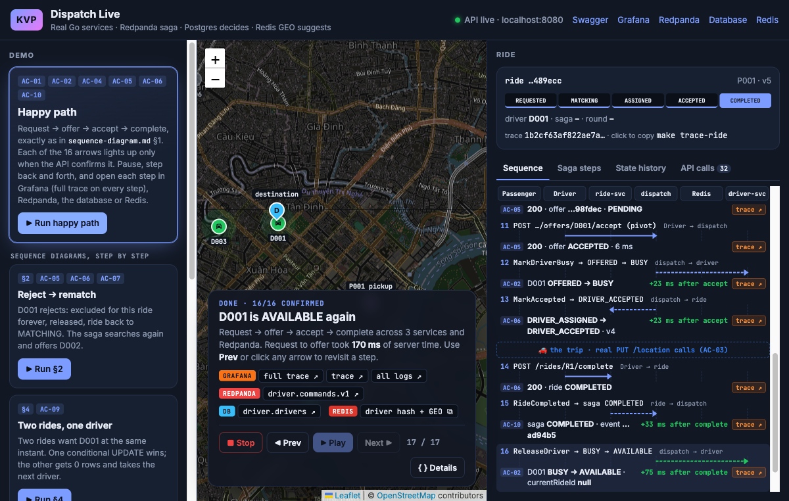</p>

**Story.** Passenger P001 at the Opera House requests a ride to Tan Dinh Church. D001 is 800 m away, D002 1.5 km, D003 2.5 km (outside), D011 is closer but offline. The ride is offered to D001, who accepts, drives there (the app sends its location every 2 s) and completes the trip.

| AC | Input | Output |
|---|---|---|
| AC-01 | `POST /rides` + `Idempotency-Key`, P001, valid coordinates | `201`, new `rideId`, `REQUESTED`, `traceId` |
| AC-10 | `RideRequested` through outbox → Redpanda | saga `STARTED`, ride `MATCHING` |
| AC-04 | `GEOSEARCH` within the radius | D001 picked (nearest); D011 offline and D003 outside are skipped |
| AC-09 | `ReserveDriver(D001)` | `UPDATE … WHERE status='AVAILABLE'` → 1 row, D001 `OFFERED` |
| AC-05 | Offer created | `PENDING`, expires in 30 s, ride `DRIVER_ASSIGNED` |
| AC-05 | `POST …/offers/D001/accept` | `200 ACCEPTED`, ride `DRIVER_ACCEPTED`, D001 `BUSY` |
| AC-03 | `PUT /drivers/D001/location` every 2 s during the trip | latest location stored with a new version |
| AC-06 | `POST /rides/{id}/complete` | `COMPLETED` (terminal), D001 `AVAILABLE` |

**Flow.**

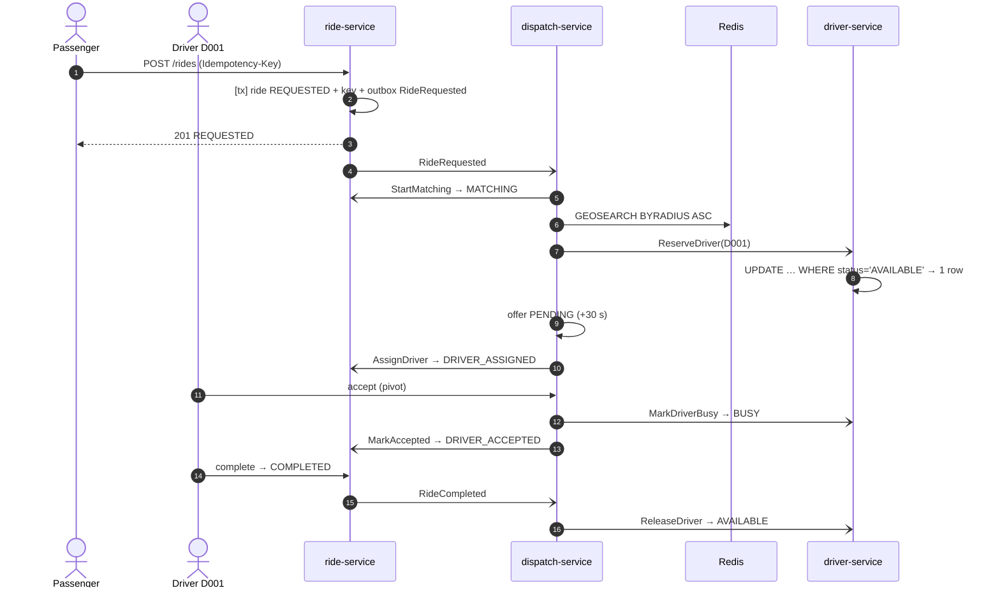

**What we solve here.** No lost event between "ride saved" and "dispatch starts" (outbox). One saga per ride even if the event is delivered twice (saga PK + inbox). Matching is in memory, but the decision is in Postgres. After the pivot, the saga only moves forward.

**Monitoring.** One trace covers all 16 steps across three services and Redpanda. Saga steps (`GET /rides/{id}/dispatch`) and state history (`GET /rides/{id}/history`) are shown live. Metrics: `offers_total{outcome="created"|"accepted"}`, time to first offer.

---

### 5.2 Reject → rematch

<p align="center">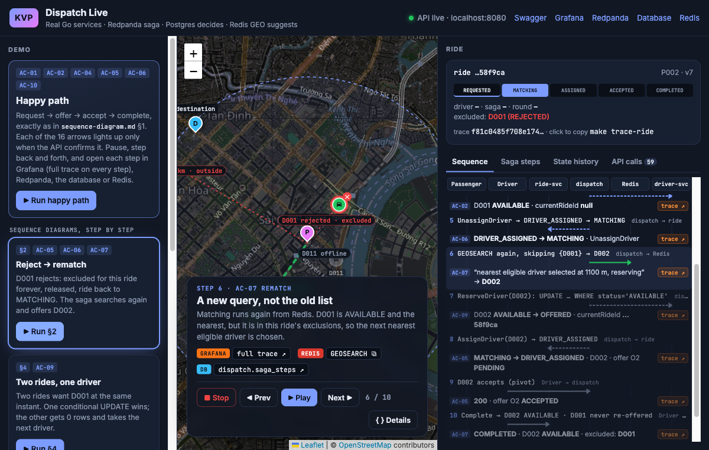</p>

**Story.** Ride R1 is offered to D001 (600 m). D001 says no. D001 must never see R1 again, but must stay free for other passengers. The saga searches again and offers R1 to D002 (1.1 km), who accepts.

| AC | Input | Output |
|---|---|---|
| AC-05 | `POST /rides/R1/offers/D001/reject` | `200 REJECTED`; only the driver holding the offer can do this |
| AC-07 | (same transaction) | `ride_exclusions(R1, D001, REJECTED)`, saga back to `MATCHING` |
| AC-02 | `ReleaseDriver(R1, D001)` | D001 `OFFERED → AVAILABLE` (only `WHERE current_ride_id = R1`) |
| AC-06 | `UnassignDriver(R1)` | ride `DRIVER_ASSIGNED → MATCHING`, `assignedDriverId = null` |
| AC-07 | New `GEOSEARCH` | D001 is nearest **and** AVAILABLE, but excluded → D002 |
| AC-05 | `AssignDriver(R1, D002)`, then accept | offer O2 `PENDING` → `ACCEPTED`, ride `DRIVER_ACCEPTED` |

**Flow.**

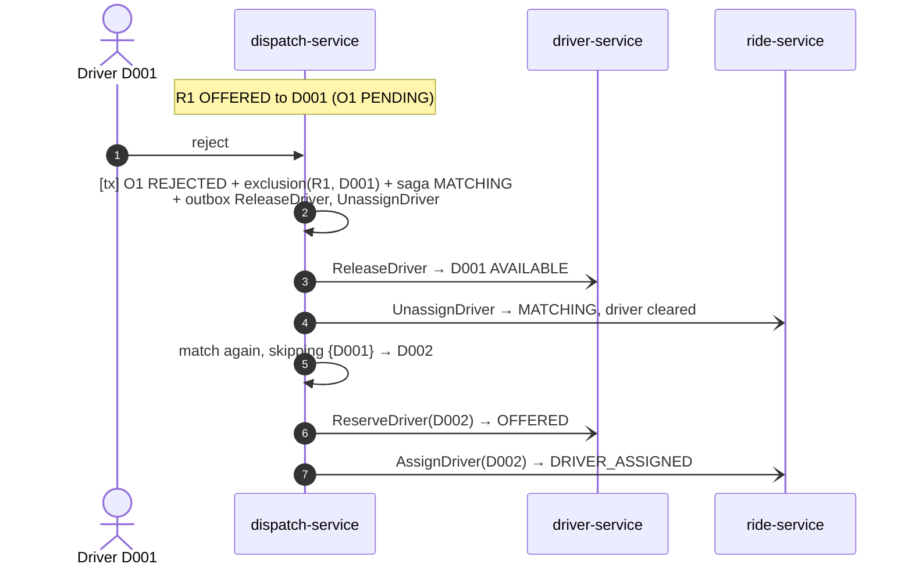

**What we solve here.** Rejection is a **compensation**: everything done for D001 is undone in the right services. Exclusion is a table row, so it survives restarts and is permanent. Rematch is a **new query**, not "promote #2 from the old list", so it uses fresh locations. A timeout follows exactly the same path (the sweeper marks the offer `EXPIRED`).

**Monitoring.** The trace shows the reject, both compensations and the second offer in one view. The **Saga steps** tab shows *"driver rejected the offer: excluded for this ride, released, ride back to MATCHING"*. Metric: `offers_total{outcome="rejected"|"expired"}`.

---

### 5.3 Two rides, one driver (the race)

<p align="center">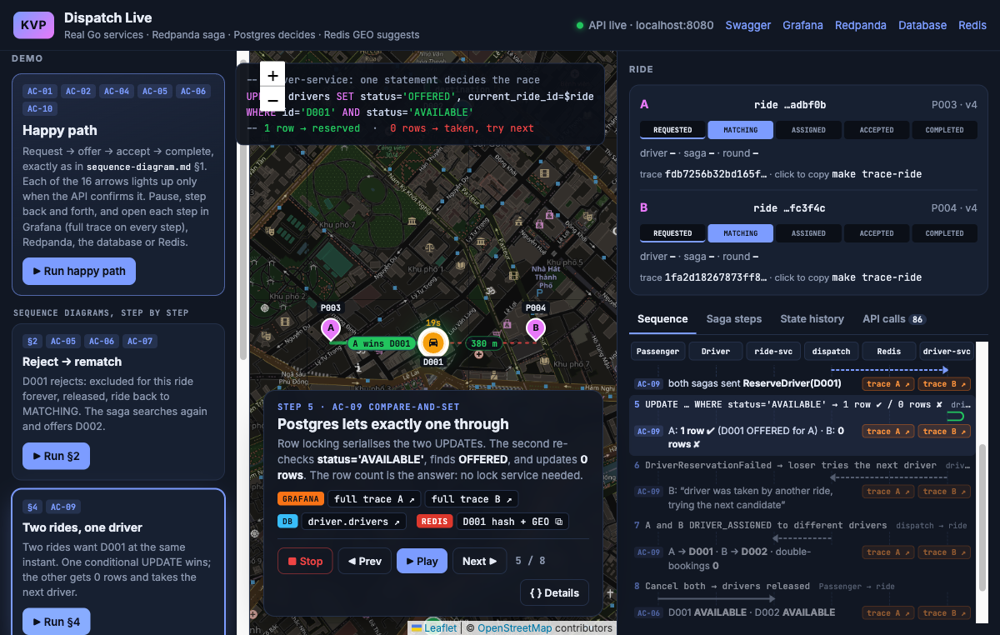</p>

**Story.** Two passengers, A and B, stand 380 m on either side of D001 and request a ride at the same instant. Both sagas see D001 as the nearest AVAILABLE driver and both try to reserve it. Only one may win.

| AC | Input | Output |
|---|---|---|
| AC-09 | `POST /rides` × 2 in parallel | two rides, two sagas |
| AC-04 | Both `GEOSEARCH` | both pick D001 |
| AC-09 | `ReserveDriver(A, D001)` ∥ `ReserveDriver(B, D001)` | first `UPDATE` → **1 row**, second → **0 rows** |
| AC-09 | `DriverReservationFailed(B)` | B: *"driver was taken by another ride, trying the next candidate"* → D002 |
| AC-09 | — | A → D001, B → D002, **double-bookings: 0** |

In our demo runs the two reservations **really collided in the database** (B lost once, A lost once), and the result was correct both times.

**Flow.**

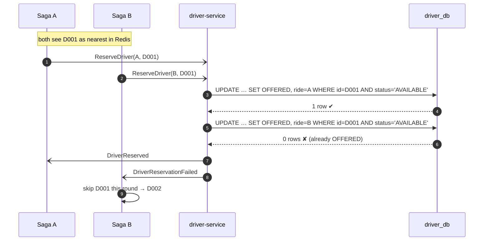

**What we solve here.** The classic lost update ("read AVAILABLE, then write OFFERED"). The guard is a single **compare-and-set** statement in the service that owns the driver; Postgres row locking makes the second writer wait, re-check the `WHERE` and change nothing. No lock service, correct with any number of replicas.

**Monitoring.** One trace per ride (A and B both have a trace button on every step). Metric: `driver_reservation_conflicts_total`. In a hot zone, the ratio conflicts / offers is the early warning (section 6).

---

### 5.4 Cancel vs accept

<p align="center">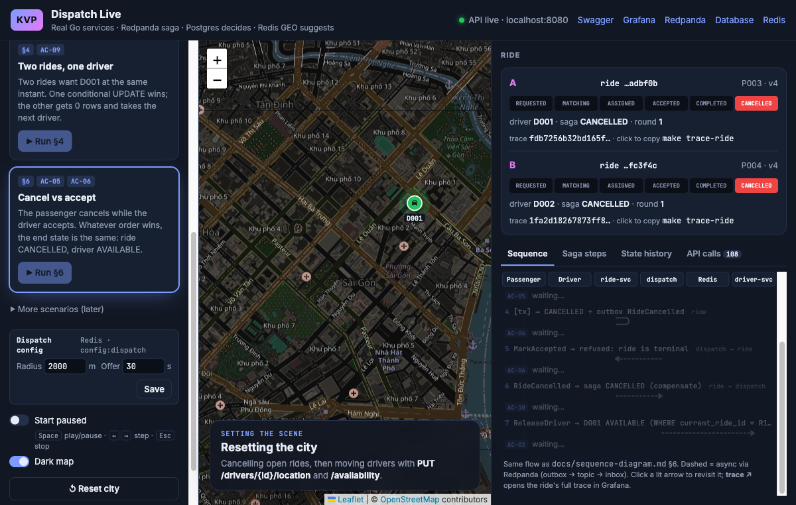</p>

**Story.** R1 has a pending offer for D001. At the same moment, the passenger taps **Cancel** and the driver taps **Accept**. Two services, two requests, no shared transaction. Whatever order they land in, the end must be: ride `CANCELLED`, driver `AVAILABLE`, saga `CANCELLED`.

| AC | Input | Output |
|---|---|---|
| AC-06 | `POST /rides/R1/cancel` | `200 CANCELLED` (ride-service owns the lifecycle) |
| AC-05 | `POST …/offers/D001/accept` (in parallel) | either `200 ACCEPTED` (offer row won) or `409` (cancel got there first) |
| AC-06 | `MarkAccepted(R1)` | refused: ride is terminal → `CommandRejected(RIDE_TERMINAL)` |
| AC-10 | `RideCancelled(R1)` | saga `CANCELLED`; the second of the two messages is a no-op |
| AC-02 | `ReleaseDriver(R1, D001)` | D001 `AVAILABLE`, `currentRideId = null` |

In our run, the accept won the offer row (`200 ACCEPTED`) **and** the cancel won the ride, so ride-service refused `MarkAccepted` and the saga compensated. The ride history has no `DRIVER_ACCEPTED`.

**Flow.**

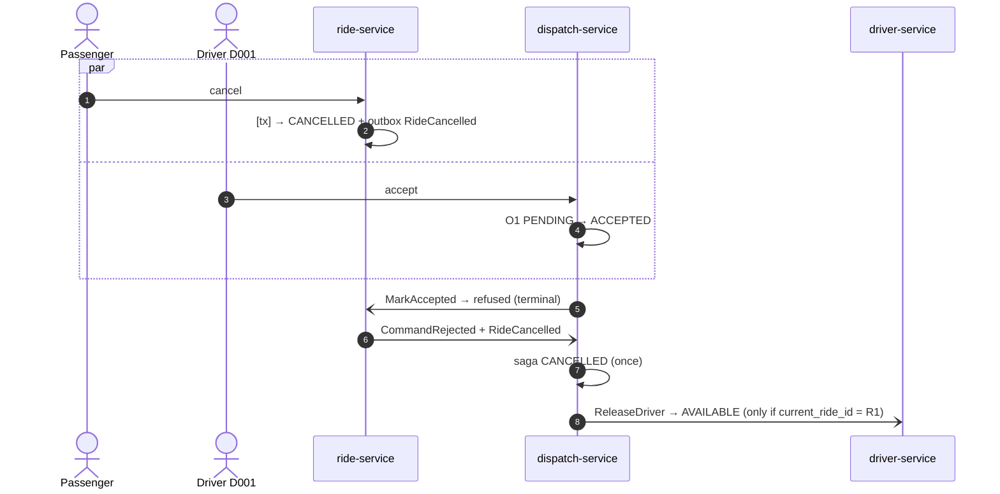

**What we solve here.** Each service decides what it owns: ride-service decides the ride, dispatch decides the offer. Terminal states are final, so a late command cannot revive a cancelled ride. Every message is safe to apply twice and in any order. `ReleaseDriver` follows `MarkDriverBusy` on the same `driverId` partition, so the driver can never get stuck in `BUSY`.

**Monitoring.** The trace shows both requests side by side and the compensation after them. The saga step says which path won: *"ride cancelled by passenger"* or *"ride refused MarkAccepted (RIDE_TERMINAL), compensating"*.

---

## 6. Scalability

### 6.1 One number explains the design

At one location update every 4 s per online driver:

| | 1,000 drivers | 100,000 drivers | 1,000,000 drivers |
|---|---|---|---|
| **Location updates** | 250 /s | 25,000 /s | **250,000 /s** |
| Ride requests (peak) | 0.2 /s | 17 /s | ~170 /s |
| Redis GEO memory | 120 KB | 12 MB | ~120 MB |

> **Rides are not the problem. Locations are.** Scaling this system means ingesting locations and querying the geo index. That is why the location path (driver-service) is its own service.

### 6.2 We measured it: k6 load tests

Victor ran three k6 scenarios against the full stack on one laptop (4 vCPU VM shared by k6, all services and Grafana), in an **open model**: requests keep arriving at the target rate even when the system slows down, so overload shows as latency and errors instead of hiding.

| Scenario | One iteration | Tests |
|---|---|---|
| `location` | `PUT /drivers/{id}/location`, random driver of 1,000 | location write path |
| `dispatch` | create ride → wait for offer → accept → complete, 50 areas | the saga end to end |
| `hotzone` | the same journey, all rides in **one** area with 8 drivers | contention |

### 6.3 What broke, in order

| # | Finding | Evidence |
|---|---|---|
| **F1** | 🚪 **The gateway breaks first** at ~1,000 req/s: `502`s while the services are idle | 78,450 × `502`; driver-service CPU 22 %, nginx 113–251 %; `worker_connections are not enough` |
| **F2** | 📍 **Location writes saturate** above ~1,000 req/s (≈ 4,000 online drivers), max ~1,800 req/s | p95 9 ms → 935 ms → 4.5 s; outbox backlog 114k rows |
| **F3** | 🔌 A bigger DB pool did **not** help (4 → 24 connections) | 1,233 vs 1,721 req/s; the VM was ~95 % busy |
| **F4** | 🔥 **Hot zone = contention, not capacity** | conflicts / offers 0 % → 8 % → 292 % → 555 %; 75.6 % of journeys complete; CPU < 40 %, HTTP errors 0 % |
| **F5** | ✅ **Normal dispatch is healthy** to 40 rides/s | 0 errors, HTTP p95 9 ms |

**F1: gateway (via nginx).** Each request opened a new TCP connection to the service. Fix tested: upstream keepalive + `worker_connections 16384` → **0 errors at 1,000 req/s**.

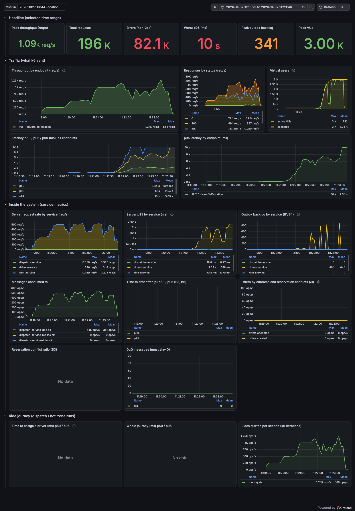

**F2: location writes (bypassing the gateway).** Each update = `UPDATE drivers` + `INSERT outbox` + later `UPDATE outbox` + a broker message to update Redis. The knee is between 1,000 and 2,000 req/s; then throughput *falls*. No data was lost: the backlog drained after the test.

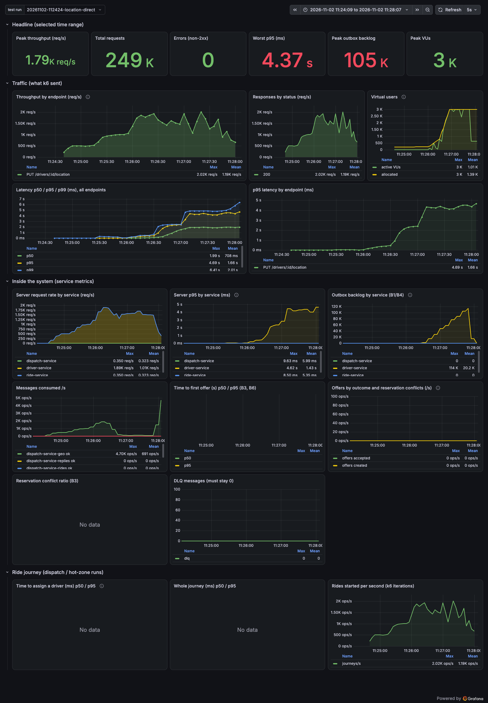

**F5: the saga.** 40 rides/s with 0 errors; at 80 rides/s the gateway (F1) failed first, not the saga.

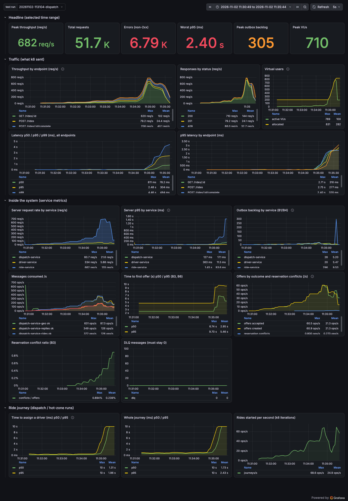

**F4: hot zone.** HTTP looks perfect (p95 253 ms, 0 errors) while a quarter of passengers get no driver. Only business metrics show it.

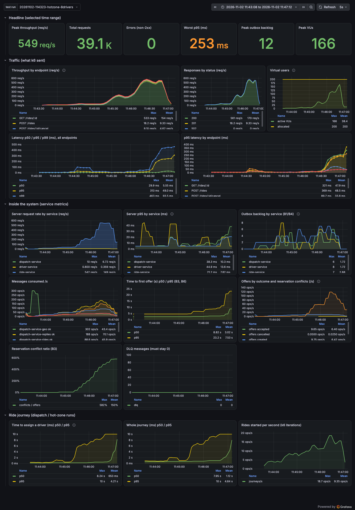

### 6.4 What it means

* The order of failure matches the design: **gateway → location writes → hot zones**. Redis GEO, partitions and the dispatch database were never the limit.
* Absolute numbers are a **floor** (everything shared one laptop). The order is the result.
* **Alert on business metrics**, not only HTTP: conflict ratio, time to assign, journey success, outbox backlog.

### 6.5 The growth path

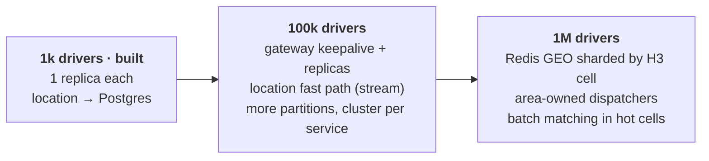

Full details: [load-test-report.md](../docs/load-test-report.md) · [scalability.md](../docs/scalability.md).

---

## 7. How we solved each problem

### 7.0 Overview

| # | Problem | Our solution | AC | In short | Read more |
|---|---|---|---|---|---|
| 7.1 | Find the nearest driver fast | **Redis GEOSEARCH** projection + Haversine in Go | 03, 04 | In-memory search, versioned updates, rebuildable | [ADR-001](../docs/adr/ADR-001-matching.md) |
| 7.2 | Two rides grab one driver | **Compare-and-set (CAS) in SQL** | 09 | `UPDATE … WHERE status='AVAILABLE'`; row count decides | [ADR-002](../docs/adr/ADR-002-concurrency.md) |
| 7.3 | One lifecycle across 3 services | **Orchestrated saga** with compensations and a pivot | 05, 06, 07, 10 | dispatch drives each ride; undo before accept, retry after | [ADR-003](../docs/adr/ADR-003-saga-orchestration.md) |
| 7.4 | Lost or duplicate events | **Transactional outbox + inbox** | 08, 10 | State and messages commit together; consumers skip repeats | [ADR-004](../docs/adr/ADR-004-messaging-outbox-inbox.md) |
| 7.5 | Client retries `POST /rides` | **Idempotency key with stored response** | 01, 08 | Same key → same ride; reused key with a new body → `422` | [patterns P8](../docs/patterns.md#p8-idempotency-key-with-stored-response) |
| 7.6 | Invalid or repeated transitions | **Explicit state machines** | 02, 06 | Pure functions: changed / duplicate (no-op) / invalid (`409`) | [patterns P7](../docs/patterns.md#p7-explicit-state-machines) |
| 7.7 | The 30 s offer timeout | **`expires_at` + sweeper with `SKIP LOCKED`** | 05 | Survives restarts; cancelled by a conditional update | [ADR-003](../docs/adr/ADR-003-saga-orchestration.md) |
| 7.8 | Message order at scale | **Redpanda, partitioned by `rideId` / `driverId`** | 10 | Order per ride, scale per partition | [ADR-009](../docs/adr/ADR-009-message-broker.md) |
| 7.9 | Change radius / timeout without a redeploy | **Redis config + 1 s in-process cache** | 04, 05 | `config:dispatch`; `PUT /dispatch/config` or `HSET` | [local-development §7](../docs/local-development.md#7-configuration) |
| 7.10 | "What happened to ride R001?" | **One trace per ride** + ids on every log line | obs. | Stored `traceparent`; Grafana Loki/Tempo | [ADR-005](../docs/adr/ADR-005-observability.md) |
| 7.11 | Boundaries that can grow | **3 services + Clean Architecture + gateway + gRPC streams** | all | Split by how parts scale; rules enforced by a test | [ADR-006](../docs/adr/ADR-006-service-architecture.md), [ADR-012](../docs/adr/ADR-012-clean-architecture.md) |
| 7.12 | Proving it works | **Tests at every level + CI + k6** | all | Races proven on a real database | [testing.md](../docs/testing.md) |

---

### 7.1 Finding the nearest driver: Redis GEO vs H3 vs PostGIS

**Problem.** Scanning every driver and computing distance is O(N) per ride. We need a **spatial index**, and it must reflect the **latest** location.

**Option A: Geohash grid (Redis GEO).** Geohash cuts the world into **squares** and turns latitude/longitude into one number; Redis stores it as a sorted-set score (~0.6 m precision). `GEOSEARCH … BYRADIUS` reads the pickup's square and its 8 neighbours, then filters by exact distance.

```
   ┌────┬────┬────┐
   │ NW │ N  │ NE │   1. choose a square size ≥ the radius
   ├────┼────┼────┤   2. read the centre square + 8 neighbours (9 range scans)
   │ W  │ ●  │ E  │   3. keep points inside the circle, sort by distance
   ├────┼────┼────┤
   │ SW │ S  │ SE │   Cost depends on drivers NEAR the pickup, not on fleet size.
   └────┴────┴────┘
```

**Option B: H3 hexagons (Uber).** H3 covers the Earth with **hexagons** at 16 sizes (res 7 ≈ 5.2 km², res 8 ≈ 0.74 km²). A hexagon's 6 neighbours are all the **same distance** away, so "this cell + one ring" is a good circle, and cells make natural **shards**.

```
   Squares (geohash)                 Hexagons (H3)
   ┌───┬───┬───┐                        ⬡   ⬡
   │ d │ e │ d │  e = edge (1×)       ⬡   ●   ⬡    6 neighbours,
   ├───┼───┼───┤  d = corner (1.41×)    ⬡   ⬡      all the same distance
   │ e │ ● │ e │
   └───┴───┴───┘  8 neighbours, 2 distances
```

**Option C: PostGIS.** `ST_DWithin` + a KNN index on the `drivers` table. Always fresh, but every location update hits the same rows the reservation locks.

| | Redis GEO | H3 cells (+ Redis per cell) | PostGIS |
|---|---|---|---|
| Speed | sub-ms, in memory | sub-ms, in memory | ms |
| Freshness | eventual (event-fed) | eventual | always fresh |
| Write load on the reservation DB | none | none | **every update** |
| Sharding | one key can't be split | **one key per cell** | shard by city |
| Complexity | **one command** | library + border queries | extension + tuning |
| Best for | up to a few 100k drivers | 1M+ drivers | small fleets |

**We chose** Redis GEO now, H3 cells on top of it at 1M drivers. Redis is only a **hint**: driver-service confirms the pick (7.2), so a stale index costs one retry, never a wrong assignment.

**How the index stays correct.** Every driver event carries a `version`. A Lua script applies an event only if it is newer, so duplicates and out-of-order events are ignored. The final choice is a pure Go function (`SelectNearest`: exclusions, Haversine, radius, tie-break), unit-tested without Redis.

References: [Redis geospatial](https://redis.io/docs/latest/develop/data-types/geospatial/) · [Uber H3](https://www.uber.com/blog/h3/) · [h3geo.org](https://h3geo.org/)

---

### 7.2 Two rides, one driver: compare-and-set (CAS) in SQL

**Problem.** "Read status → check AVAILABLE → write OFFERED" is a **check-then-act** race: two sagas can both read AVAILABLE and both write.

**Solution.** Do the check and the write in **one statement** and let the database answer:

```sql
UPDATE drivers
SET    status = 'OFFERED', current_ride_id = $ride, version = version + 1
WHERE  id = $driver AND status = 'AVAILABLE';    -- 1 row: you won · 0 rows: someone else did
```

This is **compare-and-set**: "set the new value only if the current value is still what I expect". Postgres locks the row for the first writer; the second waits, re-checks the `WHERE` on the new row and updates nothing.

| Option | Pros | Cons | Verdict |
|---|---|---|---|
| **CAS `UPDATE … WHERE status=…`** | One statement; the row count is the answer; correct across replicas and crashes; no extra infrastructure | The driver row is a serialisation point (hot zones) | ✅ |
| Distributed lock (Redis `SET NX`, Redlock) | Familiar | A lease can expire during a pause → two holders, unless the database checks again anyway | ❌ |
| Optimistic version check (`WHERE version = $v`) | General purpose | Needs a read first; more retries | Used for rides |

**The same CAS decides every race:**

| Race | Statement |
|---|---|
| accept vs reject vs timeout vs cancel | `UPDATE offers … WHERE id=$o AND status='PENDING' [AND expires_at > now()]` |
| late release of a driver who moved on | `UPDATE drivers … WHERE id=$d AND current_ride_id=$ride` |
| ride transitions | `SELECT … FOR UPDATE`, state machine, `UPDATE … version+1` |

**Defence in depth:** partial unique indexes (one `PENDING` offer per driver and per ride) and a `CHECK` on drivers. **Proof:** 50 rounds of two goroutines behind a barrier on real Postgres; exactly one wins every time. **Cost (seen in k6, F4):** in a hot zone many sagas chase the same rows → batch matching per area is the fix (section 8).

---

### 7.3 One lifecycle across three services: orchestrated saga

**Problem.** Ride, driver and offer live in three databases. The flow loops (rematch), waits (30 s) and must be undoable (cancel).

| Option | Verdict | Why |
|---|---|---|
| Two-phase commit | ❌ | Blocking; a coordinator crash leaves locks; Kafka can't take part |
| Choreography (services react to events) | ❌ | The loop, timer and exclusions have no owner; "what happened?" needs many streams |
| **Orchestration, hand-rolled** | ✅ | One owner; every step visible in SQL, logs and one trace; no extra server |
| Temporal | later | Great when there are many workflows; hides the mechanics we wanted to show |

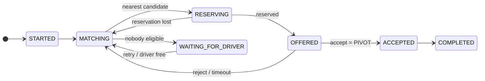

**The pivot.** Before the driver accepts, every step has a compensation (release driver, unassign ride, cancel offer). After it, steps are only retried. Background workers expire offers, retry waiting rides and re-send the last command of a stuck saga.

---

### 7.4 Lost or duplicate events: outbox + inbox

**Problem (dual write).** "Save to Postgres, then publish to Kafka" can half-fail: the ride is saved but the event is lost (stuck ride), or the event goes out but the save rolls back (phantom).

```
 ┌──────────── one Postgres transaction ────────────┐
 │ INSERT inbox(consumer, event_id) → conflict? skip │  ← duplicates stop here
 │ UPDATE business row (state machine)               │
 │ INSERT outbox(message, traceparent)               │  ← the event commits with the state
 └───────────────────────────────────────────────────┘
        relay (every 50 ms) → Redpanda → next consumer (same pattern)
```

| Option | Verdict | Why |
|---|---|---|
| **At-least-once + idempotent consumers** | ✅ | No loss; works with any broker |
| Kafka "exactly-once" | ❌ | Covers Kafka only; the Postgres write is outside it |
| Outbox + CDC (Debezium) | later | Lower latency at volume; needs Kafka Connect |

**Failure:** the transaction rolls back and the offset is not committed → retry 5× with backoff and jitter → `<topic>.dlq` + `make replay-dlq`.

---

### 7.5 Client retries: idempotency key with stored response

The key row is inserted **first, in the ride's transaction**, with a hash of the request and the response.

| Case | Result |
|---|---|
| Same key, same body | original `201` + `Idempotent-Replayed: true`, no new ride |
| Same key, different body | `422 IDEMPOTENCY_KEY_REUSED` |
| Same key, 10 requests in parallel | the others wait on the key's row lock, then replay → **1 ride** |

Why not "check if the key exists, then insert"? That is the same check-then-act race as 7.2; the primary key makes it atomic.

---

### 7.6 Explicit state machines

Each state machine is a pure function that returns one of three answers:

| Answer | Example | Effect |
|---|---|---|
| **changed** | `MATCHING → DRIVER_ASSIGNED` | stored + history row + event |
| **duplicate** | `DRIVER_ACCEPTED → DRIVER_ACCEPTED` (same driver) | `200`, nothing changes (AC-08) |
| **invalid** | `COMPLETED → DRIVER_ASSIGNED` | `409 INVALID_TRANSITION` |

Table-driven unit tests cover every pair of states.

---

### 7.7 The 30 s offer timeout

| Option | Problem |
|---|---|
| In-memory timer | lost on restart |
| Broker delayed message | Kafka/Redpanda has none; hard to cancel when the driver answers |
| **`offers.expires_at` + sweeper** ✅ | survives restarts; cancelled for free by the CAS on `status='PENDING'` |

The sweeper runs every second with `FOR UPDATE SKIP LOCKED`, so several dispatch replicas never block each other, and an offer expires at most once. Accept also checks `expires_at > now()`, so a click one millisecond late loses fairly.

---

### 7.8 Order and scale: Redpanda, partitioned by key

| Option | Pros | Cons | Verdict |
|---|---|---|---|
| **Redpanda** | Kafka API, one binary, no JVM/ZooKeeper, starts in seconds | smaller community | ✅ |
| Apache Kafka | the standard | heavier on a laptop | switching = one env var |
| RabbitMQ | simple, delayed messages | no replayable partitioned log | ❌ |

Keys: `rideId` for ride topics and replies, `driverId` for driver topics. All messages about one ride land on one partition, **in order**; services scale out **by partition**.

---

### 7.9 Runtime config with a cache: radius and timeout in Redis

**Problem.** The radius (AC-04) and the offer timeout (AC-05) must be configurable. As env vars, changing them means a redeploy, and every replica must agree.

**Solution.** The values live in a Redis hash, read through a short **in-process cache**:

```
 dispatch start ──HSET (env values)──►  Redis  config:dispatch { match_radius_m: 2000, offer_timeout_s: 30 }
 PUT /dispatch/config ──validate──► HSET ─┘   ▲
 redis-cli HSET (by hand) ────────────────────┘   │ HGETALL at most once per second per replica
                                                  │
 matching / offer creation ──► in-process cache (TTL 1 s) ──► falls back to env values if Redis fails
```

| Option | Pros | Cons | Verdict |
|---|---|---|---|
| Env vars only | simplest | redeploy to change | ❌ (still the seed) |
| A table in Postgres | durable, transactional | a DB read per match, or a cache anyway | ❌ |
| **Redis hash + 1 s in-process cache** | change at runtime; all replicas agree within 1 s; no Redis call per ride; Redis already in the stack | a change takes up to 1 s; resets to env on restart | ✅ |
| Config service (etcd, Consul) | watches, history | another cluster to run | at larger scale |

**Safety:** values are validated (radius 100–50,000 m, timeout 1–3,600 s) → `422 INVALID_SETTINGS`. A bad value written by hand is ignored (env values used, warning logged). If Redis loses the key, defaults are written back. A ride keeps the **radius it started with** (stored on the saga), so a change never moves the goalposts mid-dispatch.

**Other caching in the design:** the Redis GEO index is itself a **read model** (CQRS), not a cache of rows. At 100k+ drivers, a ~1 s cache on `GET /rides/{id}` and push instead of polling would remove most reads (k6 F4 showed the polling storm).

---

### 7.10 Observability: one trace per ride

* **Logs:** every line carries `ride_id`, `driver_id`, `event_id`, `causation_id`, `trace_id`.
* **Traces:** the ride's `traceparent` is stored on the ride and the saga, so a timeout 30 s later still joins the same trace.
* **Metrics:** offers by outcome, time to first offer, reservation conflicts, outbox backlog, consumer outcomes, HTTP latency.
* **Demo:** every step has a `trace ↗` button straight into Tempo.

---

### 7.11 Boundaries: 3 services, Clean Architecture, gateway, gRPC

| Choice | Why | Cost |
|---|---|---|
| **3 services, database per service** | Parts scale differently (locations ≫ rides); team learning goal | Eventual consistency; more infrastructure; over the timebox |
| **Clean Architecture** | Use cases tested with fakes; SQL in one adapter; a test enforces the rules | More files, ~15 interfaces |
| **nginx gateway** | Clients see one API; `/internal/*` hidden | First bottleneck under load (F1) |
| **gRPC streams** for location and offers | One connection instead of a request every few seconds; offers pushed | Two API styles to maintain |

A modular monolith would be enough for 1,000 drivers ([ADR-006](../docs/adr/ADR-006-service-architecture.md)); we chose services on purpose and kept them to three.

---

### 7.12 Proving it works

```
            ▲  k6 load tests: location, dispatch, hot zone
           ▲▲  Postman: 115 checks, one folder per AC
          ▲▲▲  E2E: REST + gRPC through the gateway, OpenAPI contract, real timeout
       ▲▲▲▲▲▲  Integration: real Postgres 18 / Redis 8 (races, idempotency, saga, config)
   ▲▲▲▲▲▲▲▲▲▲  Unit + architecture: state machines, matching, settings, use cases
```

AC-09 is proven on a **real database**: an in-memory fake cannot show row-lock behaviour.

---

## 8. 3 bottlenecks · 3 scaling strategies · 2 trade-offs

### 3 bottlenecks (2 confirmed by k6, 1 new)

| # | Bottleneck | Breaks at (our rig) | Evidence |
|---|---|---|---|
| **B1** | 📍 **Location writes**: each update = row update + outbox insert + outbox update + broker message | ~1,000 req/s ≈ 4,000 online drivers | k6 F2: p95 4.5 s, backlog 114k |
| **B2** | 🔥 **Hot zones**: many rides chase the same few drivers; more servers don't help | when demand ≈ the area's driver capacity | k6 F4: conflicts 555 %, 75.6 % success, CPU < 40 % |
| **B3** | 🚪 **Gateway**: a new TCP connection per request, 1,024 connections max | ~1,000 req/s | k6 F1: 78k × `502` (found by testing, not predicted) |

Next in line (not reached by our tests): one Redis GEO key, partition count, the dispatch database.

### 3 scaling strategies

| # | Strategy | Fixes | What it does |
|---|---|---|---|
| **S1** | **Location fast path** | B1 | Drivers stream locations over gRPC (built). Location goes to a compacted topic, not a Postgres row per update; snapshot to Postgres every 30 s. Status changes stay transactional. |
| **S2** | **Geo partitioning (H3) + area-owned dispatch + batch matching** | B2 | One GEO key per H3 cell; one dispatcher owns an area; in hot cells collect requests for ~200 ms and assign them together. |
| **S3** | **Horizontal scale of the stateless tier** | B3, throughput | Gateway keepalive + 2+ replicas behind a load balancer (tested: 0 errors at 1,000 req/s); 3+ replicas per service; more partitions. |

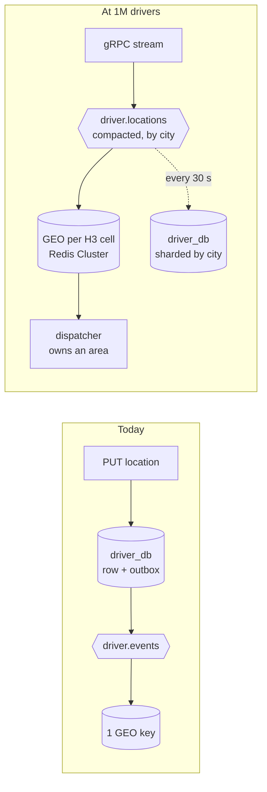

### 2 architectural trade-offs

| # | We chose | Over | Gained | Paid |
|---|---|---|---|---|
| **T1** | **Microservices + saga** | Modular monolith | The location path scales alone; clear ownership; hands-on distributed patterns | Eventual consistency, more infrastructure, well over the 4–6 h timebox. k6 showed it: under load, `complete` sometimes got `409` because the ride turned `DRIVER_ACCEPTED` a moment after the accept call |
| **T2** | **Redis GEO projection** (eventually consistent) | Querying Postgres per match | In-memory matching; location writes never touch the reservation rows | A candidate may be stale → one failed reservation, **never a wrong assignment**, because Postgres decides (7.2) |

---

## 9. What we learned, discussion and conclusion

### What we learned

1. **Correctness lives with the data owner, not in the cache.** "Redis suggests, Postgres decides" made matching fast *and* safe.
2. **One CAS statement beats a lock service.** Every race we found was decided by `UPDATE … WHERE …` and its row count.
3. **Design for duplicates.** At-least-once is a given; outbox + inbox + idempotent state machines made "what if this arrives twice?" a non-question.
4. **Name the pivot.** Once we agreed "accept is the point of no return", the compensation rules were obvious.
5. **The edges are the work.** Cancel during reserve, accept one millisecond before timeout, a reply lost in a crash: most of our tests and diagrams are about these.
6. **Measure, don't guess.** k6 found a bottleneck we never predicted (the gateway) and showed our 50k-driver estimate for location writes was optimistic on one machine.
7. **HTTP metrics can lie.** In the hot zone, latency and errors looked perfect while a quarter of passengers got no driver. Alert on business metrics.
8. **Write it down while you decide.** The ADRs ended debates and made this presentation easy.

### Known limitations

| Limitation | Next step |
|---|---|
| Accept returns at the pivot; the ride shows `DRIVER_ACCEPTED` a few ms later | Return the expected final state |
| A ride with no driver waits in `MATCHING` forever | Auto-cancel after a max wait |
| One outbox relay per instance | Leader election or CDC |
| No cleanup of inbox/outbox/idempotency rows | Time-based deletes |
| Gateway fix tested but not committed | Keepalive + replicas |
| Load tests on one shared laptop | Repeat on dedicated hosts |
| No authentication | JWT at the gateway |

### Discussion

* Would you start as a **modular monolith** and split out the location path later? Where is the line?
* **Greedy nearest vs batch matching**: when does area-wide assignment beat the simple rule?
* **Hand-rolled saga vs Temporal**: how many workflows before an engine pays off?
* Our hot zone failed **silently** at the HTTP level. Which metric would you page on?

### Conclusion

| | |
|---|---|
| **Requirements** | All 10 ACs met, each traced to code and an automated test |
| **Correctness** | Every race decided by one CAS statement in the owning service; duplicates harmless everywhere |
| **Architecture** | 3 services, saga + outbox/inbox, Redis GEO + live config, Postgres as the truth, one trace per ride |
| **Evidence** | Unit, integration, e2e, Postman, CI, a live demo of 4 sequence diagrams, and k6 load tests |
| **Growth** | Measured bottlenecks and a clear path: gateway → location fast path → H3 areas and batch matching |

> **One mission:** a dispatch service small enough to run with `make up`, correct under races and duplicates, measured under load, and ready to grow. **Thank you! Questions?** 🙌

**Links:** [README](../README.md) · [Architecture](../docs/architecture.md) · [Sequence diagrams](../docs/sequence-diagram.md) · [Patterns](../docs/patterns.md) · [Scalability](../docs/scalability.md) · [Load test report](../docs/load-test-report.md) · [ADRs](../docs/adr/README.md) · [Testing](../docs/testing.md)
