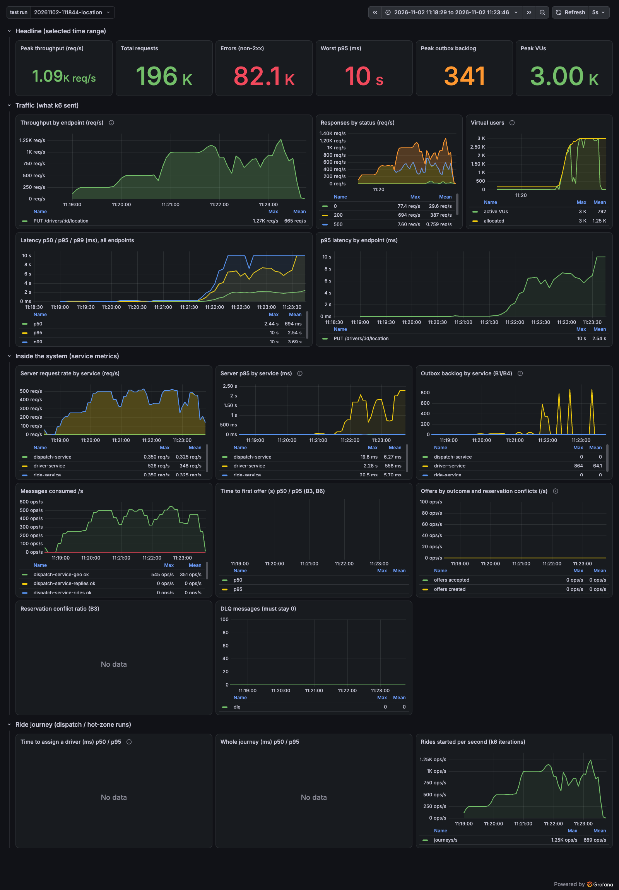
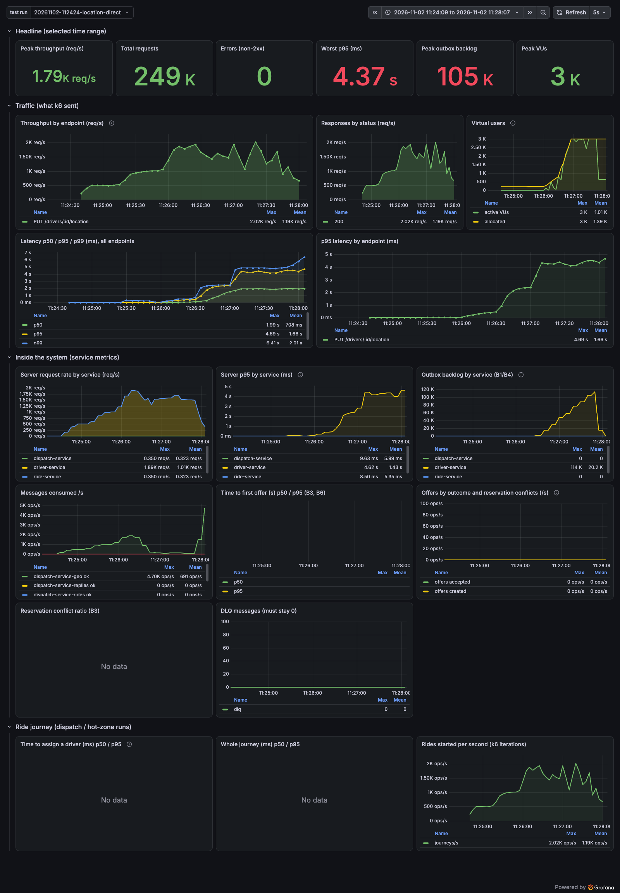
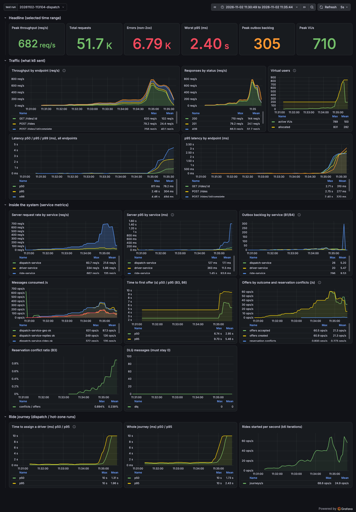
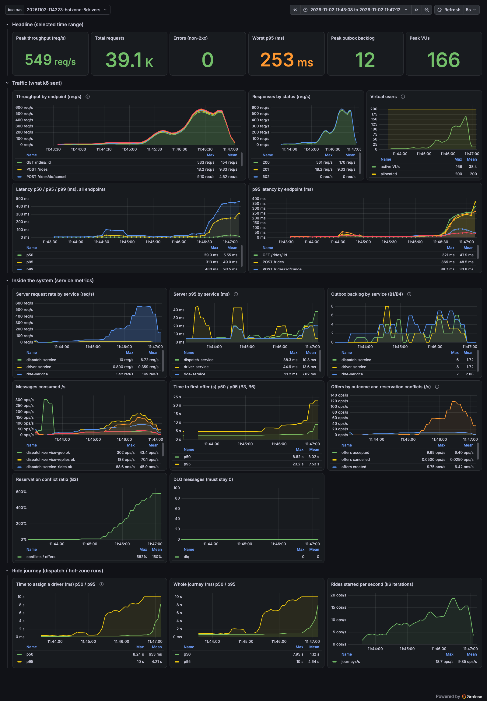

# Load Test Report: Bottlenecks and How to Scale

Date: 2026-11-02 · System: ride-hailing dispatch (ride / driver / dispatch services, Postgres, Redis, Redpanda) · Tool: k6 2.3 → Grafana · Scripts: [loadtest/](../loadtest/README.md) · Design under test: [scalability.md](scalability.md)

## 1. Summary

We load-tested the **1,000-driver topology** (one instance of everything) to find which component breaks first, and compared the result with the bottlenecks predicted in [scalability.md §4](scalability.md#4-bottlenecks).

| # | Finding | Evidence | Status vs. prediction |
|---|---|---|---|
| **F1** | **The nginx gateway breaks first, at ~1,000 req/s**: it returns `502` while the services are idle | 78,450 of 195,551 requests got 502; driver-service CPU 22 % while gateway 113–251 %; nginx logs `1024 worker_connections are not enough` | **New: not in the design doc** |
| **F2** | **Driver location writes degrade above ~1,000 req/s** (≈ 4,000 drivers at one update per 4 s) and collapse at ~1,700 req/s. The outbox backlog grows to 114k rows | p95 9 ms → 935 ms → 4.5 s; server-side p95 = client-side p95, so the time is spent inside driver-service | **Confirms B1 + B4** (shape), not the 50–100k drivers estimate (see caveats) |
| **F3** | **A bigger DB pool did not help** (4 → 24 connections) | 1,233 vs 1,721 req/s achieved; the 4-vCPU test VM was ~95 % busy | Hypothesis rejected |
| **F4** | **Hot zone: contention, not capacity.** 8 drivers in one area: conflicts / offers 0 % → 8 % → 292 % → 555 % as load goes 4 → 18 rides/s; only 75.6 % of journeys complete | CPU of every container < 40 %; HTTP p95 only 253 ms, error rate 0 %; the failure is visible only in business metrics | **Confirms B3** |
| **F5** | **Normal ride flow is healthy up to 40 rides/s** (0 errors, HTTP p95 9 ms); above that the gateway (F1) fails first | see §5.3 | The saga was not the limit in this setup |
| **F6** | **Observability gaps**: the service-side match-latency histogram is unusable, and there are no CPU, Postgres, Redis or broker metrics in Grafana | `dispatch_match_duration_seconds` p95 reads 4.75 s at every load (= 0.95 × the first 5 s bucket) | New |

**What to do, in order** (details in §7): (1) fix the gateway, (2) build the S1 location fast path before ~4,000 online drivers, (3) add batch matching / area ownership (S5, S2) for hot zones, (4) fix the metrics, then repeat these tests on dedicated infrastructure.

## 2. Test setup

| Item | Value |
|---|---|
| Environment | One MacBook, Colima VM with **4 vCPU / 7.7 GB**. k6, gateway, 3 services, Postgres 18, Redis 8, Redpanda, Grafana LGTM all share it |
| Topology | 1 replica per service, 1 Postgres (3 databases), 1 Redis, 1 Redpanda node (6 partitions per topic), nginx gateway |
| Load model | **Open model** (`ramping-arrival-rate`): requests keep arriving at the target rate even when the system is slow, so overload shows up as latency, errors and `dropped_iterations` |
| Steps | Staircase: 10 s ramp, then 30–45 s hold per step; steady-state numbers are taken from the hold part only |
| Metrics | k6 → OpenTelemetry → Prometheus (same store as the service metrics), dashboard **Load test (k6)**; CPU per container from `docker stats` every second |
| Reproduce | `make up && make load-location` (also `load-dispatch`, `load-hotzone`) then `python3 loadtest/analyze.py <run dir> --rates … --hold …` |

Scenarios:

| Scenario | What one iteration does | Tests |
|---|---|---|
| **location** | `PUT /drivers/{id}/location` for a random driver of a 1,000-driver pool | B1, B4, B5 |
| **dispatch** | `POST /rides` → poll until `DRIVER_ASSIGNED` → accept → complete, spread over 50 areas | B3, B6, saga throughput |
| **hotzone** | same journey, all rides in **one** area with few drivers | B3 |

Reading the load against the design: 1,000 drivers × one update per 4 s = **250 req/s** ([scalability §1](scalability.md#1-load-model)). So the 1,000 req/s step represents ~4,000 online drivers and the 4,000 req/s step ~16,000.

## 3. Method notes (what was discarded)

* Two runs were thrown away: one where the gateway container failed to start (mount error), and one hot-zone run where drivers left over from earlier runs were still `AVAILABLE` in the same area, so the zone was not hot. The scripts now take their drivers offline in `teardown()`.
* The **dispatch** run (§5.3) used areas that overlap cells seeded by the location test, so driver supply per area was above the nominal 20. It does not affect the gateway failure, but the saga numbers there are optimistic.
* The k6 `Max VUs` and the Prometheus percentiles are bucket-resolution estimates; exact overall percentiles are in each run's `k6.log`.

## 4. Traffic report

Every run, as seen by k6 (whole run, including ramp):

| Run | Requests | Mean req/s | Failed | Notes |
|---|---:|---:|---:|---|
| location via gateway, 250 → 4,000 req/s | 195,551 | 685 | 41.9 % (mostly 502) | 211,749 iterations dropped |
| location **direct to driver-service**, 500 → 4,000 req/s | 246,531 | 1,222 | 0 % | 131,222 dropped; p95 2.8 s overall |
| location direct, DB pool 24 | 136,821 | 1,120 | 0 % | 65,728 dropped |
| location via gateway with keepalive (experiment) | 72,858 | 515 | 0.02 % | 22,698 dropped (2,000 req/s step overloaded) |
| dispatch via gateway, 5 → 80 rides/s | 51,483 | 196 | 11.6 % | 6,475 journeys, 98.3 % ok; time to assign p95 13.4 s |
| hot zone, 8 drivers, 4 → 18 rides/s | 39,132 | 185 | 1.3 % | 2,014 journeys, 75.6 % ok, 487 rides found no driver in 10 s |

Traffic mix of the dispatch journey: about 8 HTTP requests per ride (1 create, ~4–6 polls, accept, complete), so **80 rides/s ≈ 640 req/s** at the gateway.

## 5. Results

### 5.1 F1: the gateway fails first (location via gateway)

Steady-state per step (hold part only):

| Target req/s | Achieved | p50 ms | p95 ms | Errors | driver-service CPU | gateway CPU (avg / peak) |
|---:|---:|---:|---:|---:|---:|---:|
| 250 | 253 | 3 | 5 | 0 | 17 % | 6 / 24 |
| 500 | 472 | 3 | 19 | 0 | 30 % | 24 / 43 |
| 1,000 | 1,009 | 4 | 124 * | **22,375** | 22 % | **113 / 251** |
| 2,000 | 758 | 1,842 | 5,715 | 13,432 | 37 % | 126 / 217 |
| 4,000 | 992 | 1,940 | 6,804 | 25,652 | 25 % | 153 / 321 |

\* the percentile is flattered by 502s that fail in 0 ms.



Why: [deploy/nginx.conf](../deploy/nginx.conf) proxies through variables with no upstream keepalive, so every request opens a **new TCP connection** to the service, and nginx uses the default 1,024 worker connections. Under load nginx logs `worker_connections are not enough` and answers `502` (`duration_ms: 0`, the connect never completed). Status breakdown of the run: 112,582 × 200, 78,450 × 502, 3,295 × 0 (k6 timeout), 224 × 500. The same 502s hit the dispatch run at ~640 req/s (75 warnings).

**Verified fix (experiment, not committed):** upstream blocks with `keepalive 256`, `proxy_set_header Connection ""` and `worker_connections 16384`. Result: **0 errors at 1,000 req/s and no warnings**; the system then fails at the next limit (F2), p95 at 1,000 req/s was 473 ms. Trade-off: static `upstream` blocks resolve service names once at startup, which loses the "re-resolve after a container is recreated" behaviour the file currently documents. In Kubernetes the Service/ingress layer does this job.

### 5.2 F2 + F3: location writes in driver-service (bypassing the gateway)

k6 pointed at `driver-service:8080` directly:

| Target req/s | Achieved | p50 ms | p95 ms | p99 ms | Errors | Max VUs | Outbox backlog (max) |
|---:|---:|---:|---:|---:|---:|---:|---:|
| 500 | 511 | 3 | 5 | 9 | 0 | 1 | 18 |
| 1,000 | 1,025 | 3 | 9 | 32 | 0 | 2 | 32 |
| 2,000 | 1,721 | 188 | 935 | 2,071 | 0 | 789 | 1,764 |
| 3,000 | 1,603 | 1,903 | 4,263 | 4,853 | 0 | 3,000 | 58,001 |
| 4,000 | 1,373 | 1,964 | 4,538 | 5,219 | 0 | 3,000 | 114,353 |



What the dashboard shows:

* **Knee between 1,000 and 2,000 req/s.** Below it p95 ≤ 9 ms. Above it, throughput stops growing (peak ~1.8k req/s) and then *falls*: the signature of saturation.
* **Server p95 ≈ client p95** (4.6 s vs 4.7 s): the delay is inside driver-service and its database, not in the network or gateway.
* **Outbox backlog** (`outbox_unpublished`, driver-service only) grows to 114k rows: the relay cannot publish as fast as updates arrive. Each location update costs one `UPDATE drivers`, one `INSERT outbox`, and later one `UPDATE outbox SET published_at`, plus a broker message that `dispatch-service-geo` consumes (peak 4.7k msg/s) to update Redis. That is B1/B4 write amplification.
* After the load stops, the backlog drains and the consumer spikes: no data loss, only delay.

CPU during the steps (avg %, one core = 100; the VM has 400):

| Target req/s | k6 | driver-service | postgres | lgtm (Grafana stack) | Sum of all containers |
|---:|---:|---:|---:|---:|---:|
| 500 | 18 | 21 | 14 | 23 | ~95 |
| 1,000 | 30 | 42 | 30 | 49 | ~190 |
| 2,000 | 73 | 63 | 53 | 105 | ~330 |
| 3,000 | 110 | 73 | 44 | 88 | ~330 |

**F3, DB pool experiment.** pgx defaults to `max(4, NumCPU)` = 4 connections, so we set `pool_max_conns=24` for driver-service. Achieved 1,233 req/s at the 2,000 target (vs 1,721 with 4) and p95 1,038 ms (vs 935 ms). **No improvement**, so the pool is not the limit. In that run the containers summed to ~380 % of the VM's 400 %, with the Grafana stack (`lgtm`, 100–160 %) and k6 (90–135 %) taking more than half. The honest conclusion is that **on this rig the ceiling is shared CPU plus the write path together, and we cannot separate Postgres from the rest.** A dedicated Postgres and a lighter load generator host are needed to measure B1 itself.

What this means for capacity: location updates stay healthy to **~1,000 req/s ≈ 4,000 online drivers**, degrade at ~6,800 drivers, and the S1 trigger in the design doc (~50k drivers) is optimistic **for this topology** because the shared test VM and the per-update outbox/projector chain cost more than the doc assumed. The doc's number was for a dedicated database; re-measure there before moving the trigger.

### 5.3 F5: ride journey through the saga (dispatch)

| Rides/s target | Requests/s (all calls) | HTTP p95 ms | Errors | Notes |
|---:|---:|---:|---:|---|
| 5 | 21 | 7 | 0 | |
| 10 | 42 | 9 | 0 | |
| 20 | 83 | 7 | 0 | |
| 40 | 180 | 9 | 0 | still healthy |
| 80 | 643 | 2,182 | 3,416 | 502s from the gateway (F1); journey ok 98.3 % overall; time to assign p95 13.4 s |



* The saga, outbox, Redis match and reservations handled **40 rides/s with 0 errors** (the 1M-driver design load is ~170 rides/s, ~500 in bursts, so 40 rides/s is about a quarter of the steady target, on one instance of everything).
* At 80 rides/s the first failure is the gateway (F1): 502s on `POST /rides` (85), `GET /rides/:id` (1,859) and `complete` (2,420).
* 1,629 `409` on `complete`: the ride becomes `DRIVER_ACCEPTED` asynchronously after the accept call, and under load that lag grows. The script retries, which is why journeys still succeed. This is the eventual-consistency trade-off T2 made visible.
* Not yet measured: the saga limit with a fixed gateway. Repeat with the gateway fix before drawing conclusions about B6.

### 5.4 F4: hot zone (B3)

All rides in one area, **8 drivers**, journey ≈ 0.75 s, so capacity is ≈ 10 rides/s.

| Rides/s target | HTTP requests/s (all calls) | HTTP p95 ms | Conflicts / offers | Time to first offer (service p95) |
|---:|---:|---:|---:|---:|
| 4 | 17 | 7 | 0 % | not usable (F6) |
| 8 | 35 | 9 | 8 % | not usable |
| 12 | 217 | 7 | **292 %** | not usable |
| 18 | 545 | 221 | **555 %** | not usable |

The jump in requests/s from 49 to 217 at the 12 rides/s target is the **polling storm**: rides that find no driver keep polling `GET /rides/{id}` (up to 50 times) instead of finishing, so contention also multiplies read traffic.

Whole run (k6, exact): journey success **75.6 %** (1,523 of 2,014), **487 rides found no driver within 10 s**, time to assign median 225 ms but **p95 7.8 s** (the client gives up after 10 s; in the last step even the p50 reached 8.2 s), HTTP error rate ≈ 0 %.



* **CPU stayed below 40 % in every container** (postgres 39 % avg at the top step). Adding servers would not help: the rides fight over the same few driver rows.
* A conflict ratio above 100 % means several failed reservation attempts per offer: wasted round-trips and message traffic for little progress.
* The "conflicts / offers > 20 %" trigger for batch matching (S5) crossed **between 8 and 12 rides/s, i.e. at ≈ 80–120 % of the area's driver capacity**. The alert should fire earlier: on the *offered load per driver in the area*, not on conflicts.
* This failure is **invisible in HTTP latency and error rate** (p95 253 ms, 0 errors). Only the business metrics (conflict ratio, time to assign, journey success) show it, so those are the metrics to alert on.

## 6. Bottleneck ranking (this topology)

| Rank | Component | Breaks at | Symptom | Design doc item |
|---:|---|---|---|---|
| 1 | nginx gateway | ~1,000 req/s (~4,000 drivers of location traffic) or ~640 req/s of journey traffic (~80 rides/s) | `502`, `worker_connections are not enough`, services idle | **New (G1)** |
| 2 | driver-service location write path (+ outbox relay + geo projector) | ~1,000 req/s clean, ~1,700 max | outbox backlog, seconds of latency, no errors | B1, B4 |
| 3 | Hot-zone reservation contention | offered load ≈ driver capacity of one area | conflicts ≫ offers, rides without a driver | B3 |
| – | Not reached: Redis GEO (B2), partitions (B5), orchestrator DB (B6) | | CPU of Redis ≤ 16 %, redpanda ≤ 27 % | untested at this scale |

## 7. How to scale: recommendations tied to the evidence

| # | Action | Fixes | Expected effect | Measured? | Effort |
|---:|---|---|---|---|---|
| 1 | **Gateway:** upstream `keepalive`, `worker_connections` ≥ 16k, 2+ replicas behind an LB; in Kubernetes use the ingress/Service layer | F1 | removes the 502 wall; gateway stops being the first limit | **Yes** (0 errors at 1,000 req/s) | hours |
| 2 | **S1 location fast path**: gRPC `StreamLocations` (already built) from the driver apps, location to a compacted topic, Postgres snapshot every 30 s; no `UPDATE` and no outbox row per update | F2 | removes the 3 writes and the relay load per update; expect the knee to move well above 1,000 req/s | No (design) | days |
| 3 | **Do not raise the DB pool** as a fix for location load | F3 | none | **Yes** (no gain) | none |
| 4 | **Hot zones:** batch matching per hot cell (S5, ~200 ms window) and/or area-owned dispatch (S2); until then cap offers per driver and back off retries | F4 | one decision per driver per window removes the conflict storm | No (design) | days–weeks |
| 5 | **Alerts on business metrics:** conflict ratio (> 20 % for 2 min), time to assign p95 > 2 s, journey success < 99 %, `outbox_unpublished` > 1,000; add *offered rides per available driver per area* as the early warning | F4, F2 | detects hot zones that HTTP metrics hide | **Yes** (signals verified on the dashboard) | hours |
| 6 | **Fix the metrics:** explicit histogram buckets for `dispatch_match_duration_seconds` (e.g. 5 ms … 10 s); add `postgres_exporter`, `redis_exporter`, Redpanda `/metrics` (port 9644 is already exposed), cAdvisor and pgxpool stats | F6 | CPU, locks, pool wait and consumer lag in the same Grafana | n/a | hours |
| 7 | **Re-run on dedicated infrastructure** (separate hosts for k6, services, Postgres, Redis, Redpanda), then re-set the S1 trigger from the measured number | all | turns this report's floor into real capacity | n/a | 1 day |
| 8 | Stateless services: 3+ replicas (S3), more partitions (B5), read replicas and CDC (S4) | next limits after 1–2 | needed for 100k+ drivers; not yet reached by a test | No | per [scalability.md](scalability.md) |

## 8. Limits of this report

* The VM is shared by the load generator, the system and the observability stack, so **absolute numbers are a floor; the order in which components fail is the result**.
* Single run per scenario; no repeat to measure variance. The knee positions (1,000–2,000 req/s) are ranges.
* Only one service instance each; replicas (S3), a second Redpanda node and sharding (S2, S4) are design only.
* The gateway fix and the pool change were tested with temporary configuration and are **not** in the repository.
* gRPC `StreamLocations` (the S1 transport) was not load-tested; only the REST path was.

## 9. How to reproduce

```bash
make up
make load-smoke        # 10 s check
make load-location     # F1/F2: via gateway
./loadtest/run.sh location GATEWAY=http://driver-service:8080 RATES=500,1000,2000,3000,4000 HOLD=30   # F2: bypass gateway
make load-dispatch     # F5
./loadtest/run.sh hotzone PER_AREA=8 RATES=4,8,12,18 HOLD=40   # F4
python3 loadtest/analyze.py loadtest/results/<run> --rates … --hold …   # per-step table + CPU
# Grafana http://localhost:3000 → Dashboards → "Load test (k6)" → pick the run
```
